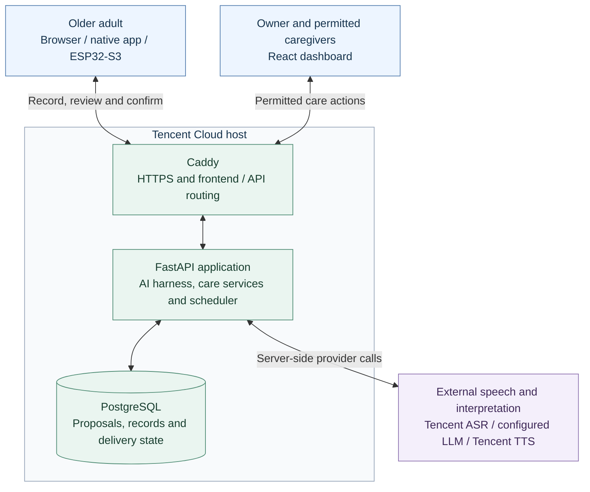
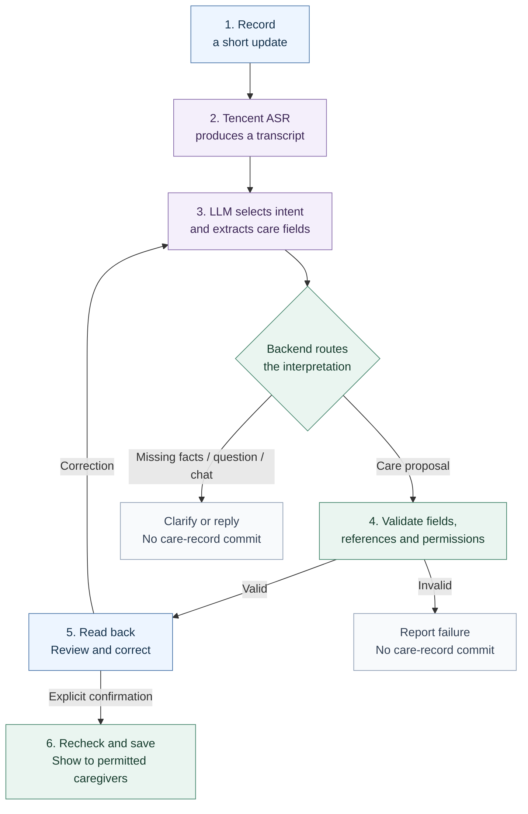

# Parse

**Turn everyday voice updates into coordinated care.**

Tencent Cloud Hackathon Singapore 2026 · Healthcare Track — NTU LKC Medicine

**Challenge 2: AI Healthier Every Day — Intelligent Support for Long-Term Self-Care**

Parse helps older adults record concerns, report medication status and blood pressure, and ask their care circle for help between appointments. A person speaks, reviews what Parse understood, and confirms the update. Permitted caregivers can then follow through, and reviewed records can support the next doctor or pharmacist conversation.

The primary software path is a **browser companion + caregiver dashboard + shared backend**. A native phone app and an ESP32-S3 cardholder use the same care system. The cardholder is an alternative voice interface for people who prefer a physical talk button.

[Architecture and AI harness](docs/architecture/README.md) · [User journey](docs/careloop/User-Workflow.md) · [Run locally](docs/careloop/Local-Demo.md) · [All documentation](docs/README.md)

## The care journey

Consider an older adult managing hypertension: a medicine is difficult to collect, a home blood-pressure reading needs recording, and a concern may otherwise be forgotten before the next appointment. Parse connects these small updates to a reviewable record and a named person's follow-through. This is the project's target scenario; intended-user and health-outcome validation remain to be completed.

| The person needs to… | Parse supports… |
| --- | --- |
| Understand an entered medication | Spoken explanations from reviewed instructions and source text |
| Keep track of a routine | Scheduled reminders and separately confirmed taken / skipped / not-yet / uncertain reports |
| Ask for practical help | A support request to a permitted caregiver, with human acknowledgement and an explicit outcome |
| Remember symptoms and readings | Confirmed health notes and externally measured blood pressure with time and source |
| Follow an existing preventive-care plan | Confirmed task updates and linked follow-ups |
| Prepare for a care conversation | Source-linked doctor-visit, family-handoff and weekly summaries with review before sharing |

## System architecture

The diagram shows the implemented components and the supplied deployment configuration. The Tencent Cloud host is the deployment target; live provider and public-backend operation need separate verification.



FastAPI runs the API, voice processing and scheduler in one process. Local demos use SQLite; Compose configures PostgreSQL. The ESP32 connects directly over Wi-Fi using HTTPS/WSS. [Architecture details, trust boundaries and trade-offs →](docs/architecture/README.md)

## From speech to a care record



The model returns **one** `{ intent, kind, payload, spoken_text }` object per utterance. The six care categories are **health note, medication report, measurement, preventive task, support request and follow-up**. The backend creates the care read-back, checks the current proposal again at confirmation, and commits the record transactionally. A recording receipt and reminder playback are tracked separately from a confirmed care fact. [Prompt, categories and worked example →](docs/architecture/README.md#how-the-ai-interprets-speech)

## Start here

| I want to… | Open |
| --- | --- |
| See the product quickly | [60-second browser walkthrough](docs/careloop/demo/parse-web-companion-demo.mp4) — fictional data, scripted speech |
| Run and test the browser workflow | [Local demo guide](docs/careloop/Local-Demo.md) — dependencies, fixture accounts and checks |
| Deploy the backend and use live speech | [Deployment](deploy/README.md) and [provider configuration](docs/careloop/PROVIDERS.md) |
| Upload firmware to the ESP32-S3 | [Setup and upload guide](firmware/README.md), then [hardware pairing](docs/careloop/Hardware-Pairing-Runbook.md) |
| Continue physical assembly and audio testing | [9 October hardware handover](docs/careloop/Hardware-Handover-2026-10-09.md) |
| Understand setup for a patient and caregiver | [First-use guide](docs/careloop/First-Use-Guide.md) |

For a dashboard-only demo after installing the [dependencies](docs/careloop/Local-Demo.md#browser-and-dashboard-requirements):

```sh
python3 tools/run_demo.py
```

The launcher starts services at `http://127.0.0.1:5173` with fictional records and live speech unconfigured. The separate [browser fixture](docs/careloop/Local-Demo.md#try-the-browser-flow-locally) exercises recording and confirmation with explicitly scripted interpretations.

## Implementation and evidence

| Area | Recorded status |
| --- | --- |
| Software care workflow | 2 October: 231 backend tests on each of SQLite and PostgreSQL 15; 132 frontend tests; 28 Chrome workflow checks. Speech responses were mocked or scripted. |
| Native phone app | 2 October: 143 compatibility tests and TypeScript check; physical-device acceptance remains separate. |
| ESP32-S3 hardware | 9 October: bench build/flash, microphone and button checks passed. Amplifier playback remains unresolved; complete physical voice flow is unverified. |
| Live AI and hosting | Provider adapters and deployment configuration are present. Repository evidence does not establish live-provider accuracy or an operational public backend. |
| Submission evidence | Actual CodeBuddy / WorkBuddy development history and at least three chat screenshots still need to be assembled and verified. |

These are dated results, not a new test run. [Software verification](docs/careloop/VERIFICATION.md) and the [hardware handover](docs/careloop/Hardware-Handover-2026-10-09.md) contain the scope and remaining acceptance work. Durable offline voice capture is disabled. Clinical effectiveness and intended-user usability have not been established.

The [product films](demos/parse-product-demo/README.md) provide a longer concept story and software tour. They were recorded on 23 September with the earlier visual design, fictional data and simulated pendant/speech interaction.

## Repository map

| Directory | Purpose |
| --- | --- |
| [`frontend/`](frontend/README.md) | React browser companion and caregiver dashboard |
| [`backend/`](backend/README.md) | FastAPI, care rules, provider adapters and persistence |
| [`mobile/`](mobile/README.md) | React Native / Expo companion |
| [`firmware/`](firmware/README.md) | ESP32-S3 cardholder firmware |
| [`deploy/`](deploy/README.md) | HTTPS and container deployment |
| [`tools/`](tools/README.md) | Local fixtures, browser checks and demo tooling |
| [`docs/`](docs/README.md) | Architecture, product guides, submission preparation and evidence |
