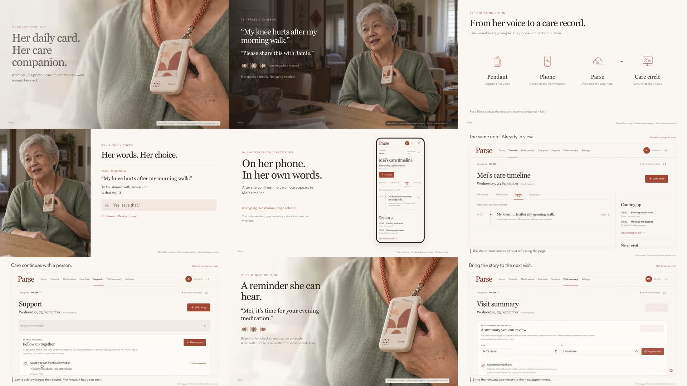

# Parse product films

Two finished, captions-only videos and their editable Remotion source. Both use Parse's ivory and terracotta design, fictional care records, and real browser recordings of the dashboard. Neither has narration, music, or an audio track.

## Watch

| Film | Download | Duration | Story |
| --- | --- | --- | --- |
| **From her voice to her care circle** | [MP4](exports/parse-companion-story.mp4?raw=true) · [captions](exports/parse-companion-story.srt) · [chapters](exports/parse-companion-chapters.txt) | 102 seconds | Mei wears the cardholder, reports discomfort, confirms a note, and shares it with Jamie. Her phone and the caregiver dashboard update automatically. |
| **Parse software walkthrough** | [MP4](exports/parse-product-demo.mp4?raw=true) · [captions](exports/parse-product-demo.srt) · [chapters](exports/chapters.txt) | 93.8 seconds | Timeline, medication reports, confirmed notes, follow-ups, support requests, visit summaries, and the phone view. |

Both exports are H.264, 1920 × 1080 at 30 fps. GitHub may show a download button instead of an embedded player.



## What the film demonstrates

The people and 3D-printed cardholder are fictional generated stills animated in Remotion. On-screen dialogue illustrates speaking; the film does not contain live-action or lip-synced speech. The pendant, speech interpretation, and proposed phone relay are simulated.

The browser scenes show the actual Parse React/FastAPI application. Authenticated fixture audio passes through its device API, creates a proposal, and is explicitly confirmed before a record is saved. Separate phone and caregiver views show the shared note through the existing automatic refresh. Caregiver acknowledgement, outcome recording, and visit-summary review use the real interface.

These films are concept and software demonstrations recorded on 23 September 2026. They do not establish physical hardware operation, Bluetooth connectivity, live speech recognition, or clinical integration. [STORY-FILM.md](STORY-FILM.md) documents the story and simulation boundaries; [STORY-IMAGE-PROMPTS.md](STORY-IMAGE-PROMPTS.md) preserves the image briefs.

## Edit and render

From this directory:

```sh
npm ci
npm run dev
npm run typecheck
npm run render:story
npm run render
```

New renders go to ignored `out/`. The published versions are in `exports/`. Captured clips and images are included in `public/`, so editing or rendering does not require a running Parse server.

`src/story/Composition.tsx` controls the pendant film; `src/Composition.tsx` controls the software walkthrough. Their scene files and timed captions are kept alongside them. Package versions are pinned in `package-lock.json`.

The configuration uses installed Google Chrome when available on macOS. Set `REMOTION_BROWSER_EXECUTABLE` to use another executable; otherwise Remotion manages its browser.

## Re-record the browser footage

The recording scripts use this repository by default. Set `PARSE_REPO_DIR` to use another checkout. Prepare the repository's backend virtual environment and frontend dependencies as described in its root README, and install `tools/` dependencies for Playwright. The JavaScript scripts also accept `PLAYWRIGHT_MODULE` for an existing Playwright installation.

For the pendant story, run `scripts/story-fixtures.py` with the backend Python interpreter, then `scripts/start-story.py` in another terminal. Record with `node scripts/record-story.cjs` and `node scripts/record-story-features.cjs`. These scripts create raw takes and timing manifests; the included edited clips remain the source for the published film.

For the software walkthrough, run `scripts/seed-recording.py`, then `scripts/seed-care-story.py` with the backend Python interpreter. Start `scripts/start-recording.py`, run `node scripts/record-demo.cjs`, and use `python3 scripts/prepare-clips.py` to trim the takes with FFmpeg.

Both recording setups use local ports 8002 and 5174 and should run separately. Their databases, audio fixtures, raw takes, credentials, and logs stay under ignored `runtime/`. All accounts and the film-only device token are explicitly fictional. The scripts must only be used for the isolated local recording environment.
