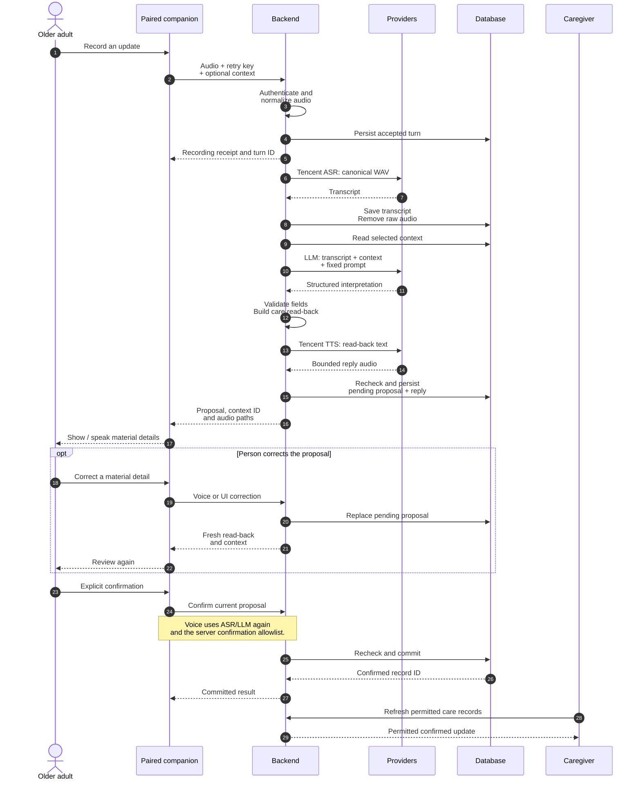
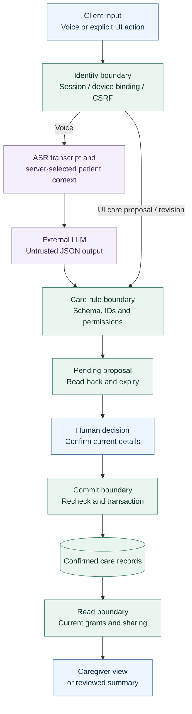

# Parse architecture and AI harness

[Project overview](../../README.md) · [Documentation index](../README.md) · [User journey](../careloop/User-Workflow.md) · [API contract](../../backend/API.md)

This guide describes the repository implementation as reviewed on 10 October 2026. Parse uses a bounded language-model interpreter inside an application-controlled care workflow. The server selects context, validates the interpretation, constructs a read-back and requires explicit confirmation before committing a care record.

The [README system diagram](../../README.md#system-architecture) is the component overview. The diagrams below explain the processing sequence and trust boundaries. These Mermaid sources are the maintained diagrams and render directly on GitHub.

## Components and ownership

| Component | Responsibility | Implementation |
| --- | --- | --- |
| Browser companion | Pairing, deliberate audio capture, receipts, review, correction and confirmation | [`Companion.tsx`](../../frontend/src/Companion.tsx), [`companionApi.ts`](../../frontend/src/companionApi.ts) |
| Owner / caregiver dashboard | Patient setup, grants, permitted timeline, Attention, summaries and care actions | [`App.tsx`](../../frontend/src/App.tsx), [`api.ts`](../../frontend/src/api.ts) |
| Native companion | Installed phone voice interface and native reminder delivery | [`mobile/src/`](../../mobile/src/), [separate acceptance status](../careloop/Phone-Companion-Verification.md) |
| ESP32-S3 cardholder | Push-to-talk recording, Wi-Fi transport and audio playback | [`firmware/main/`](../../firmware/main/), [current bench handover](../careloop/Hardware-Handover-2026-10-09.md) |
| API and identity | Sessions, CSRF, device credentials, pairing and patient access | [`main.py`](../../backend/app/main.py), [`security.py`](../../backend/app/security.py), [`web_companion.py`](../../backend/app/web_companion.py) |
| Audio acceptance | Validate uploads, normalize phone/browser audio and reconcile retry identity | [`turns.py`](../../backend/app/turns.py), [`phone_audio.py`](../../backend/app/phone_audio.py) |
| Voice orchestration | Claim turns, select context, invoke providers, route intents and prepare replies | [`worker.py`](../../backend/app/worker.py) |
| Care services | Payload rules, deterministic read-back, immutable proposals and confirmation transactions | [`services.py`](../../backend/app/services.py) |
| Provider adapters | Tencent ASR/TTS and configurable HTTPS language-model endpoint | [`providers.py`](../../backend/app/providers.py), [configuration](../careloop/PROVIDERS.md) |
| Persistence and delivery | Care records, turns, grants, audit events, reminder state and expiring audio | [`models.py`](../../backend/app/models.py), [`routing.py`](../../backend/app/routing.py), [`reminders.py`](../../backend/app/reminders.py) |

## Voice update sequence

This sequence follows a valid care proposal. A pure question or chat response follows a reply path without a care-record commit. Invalid payloads can fail processing; the application does not promise an automatic repair conversation for every failure.



Input is limited to 0.3–20 seconds. The cardholder sends 16 kHz mono PCM WAV; phone and browser formats are decoded with FFmpeg/FFprobe before the shared provider path. Turn IDs and idempotency keys support recovery after a lost response. Retrying confirmation of the same proposal returns its existing committed result rather than adding a second record. Retrying an upload with the same idempotency key returns the original turn; a new voice turn referring to an already committed proposal is rejected as stale.

Proposals expire after 120 seconds. The confirmation step rechecks proposal state and relevant records, plan versions and permissions. Browser and native clients also expose cancellation. An abandoned or expired proposal does not become a confirmed care fact. See [recording receipts](../careloop/Recording-Receipts.md) and [corrections](../careloop/Capture-and-Correction.md).

## How the AI interprets speech

### Inputs and prompt

Each interpretation call sends a fixed system prompt plus one user message containing the transcript and selected context. The implementation uses `temperature=0`, a 700-token output budget and an OpenAI-compatible `/chat/completions` endpoint. The model name is supplied through `CARELOOP_LLM_MODEL`; the repository does not establish a particular live model.

| Context | What it contributes |
| --- | --- |
| Patient preferences and server time | Preferred name, language, timezone and configured calling route |
| Current proposal / reminder | What a confirmation, correction or reference to “that dose” could refer to |
| Active medication plan and doses | Entered medicine identities, reviewed instructions and candidate scheduled doses |
| Permitted recipients | Names and IDs eligible for a proposed sharing recipient |
| Preventive tasks, support requests and follow-ups | Existing IDs and stored statuses relevant to the utterance |
| Optional capture purpose | An advisory hint such as “measurement”; never evidence of what was said |
| Reviewed names and aliases | Advisory interpreter context; currently not applied as ASR hotwords |

The context is built from current database state, rather than a full transcript of previous conversations or the patient's entire history. The prompt tells the model to preserve stated facts, ask one short question when material information is unclear, and use only supplied record and recipient identities. It also distinguishes ordinary conversation from a care event.

The full executable prompt lives in [`SYSTEM_PROMPT`](../../backend/app/providers.py). Its restrictions on diagnosis, invented medicine identities, dose changes and unsupported delivery claims are prompt instructions. Application validation and explicit confirmation provide additional checks; prompt instructions alone do not prove semantic correctness.

### Two decisions per utterance

**Intent** determines the next application action:

| Intent | Application behavior |
| --- | --- |
| `proposal` | Validate a proposed care update and prepare review |
| `correct` | Replace an identified pending proposal and require fresh review |
| `confirm` | Check explicit confirmation against the current proposal before committing |
| `clarify` | Return a question without committing a care fact |
| `explain` | Retrieve reviewed instructions for an identified medicine in the active plan |
| `support_status`, `followup_status` | Read the referenced stored status; human acknowledgement/outcome remains authoritative |
| `chat` | Return a conversational reply without creating a care record |

**Kind** selects the payload schema for a proposed care fact:

| Kind | Extracted facts | Key constraint |
| --- | --- | --- |
| `health_note` | Wording, optional symptom, occurrence and sharing recipients | Private by default; preserve approximate time |
| `medication_report` | Dose ID, taken / skipped / not-yet / uncertain state, optional taken time | Must identify a scheduled dose; playback is separate |
| `measurement` | Systolic, diastolic, unit, source, reporting actor and occurrence | External blood pressure in mmHg only |
| `preventive_task` | Existing task/state or complete new task details | Existing care-plan context; allowed transitions checked |
| `support_request` | Request, permitted recipient, routine / urgent flag, optional barrier | Validate recipient; urgency does not dispatch help |
| `followup` | Related record, check time, sharing scope, or reported resolution | Resolution requires a human-reported outcome |

For “I felt dizzy this morning,” an illustrative interpretation is:

```json
{
  "intent": "proposal",
  "kind": "health_note",
  "payload": {
    "wording": "I felt dizzy this morning",
    "symptom": "dizzy",
    "occurrence_text": "this morning",
    "share_with_user_ids": []
  },
  "spoken_text": "Would you like to record that?"
}
```

This is an example of the contract, not a recorded live-model result. For a care proposal the server replaces the model's `spoken_text` with its own read-back of the validated payload, including sharing. Only a subsequent confirmation commits the note.

### Current boundaries

- One structured interpretation per utterance; compound speech is not extracted into a list of independent care records.
- No confidence score, semantic verification model, vector search or autonomous model tool loop is implemented.
- Missing facts can lead to a clarification request. General conversation-history memory and reliable multi-turn slot filling have not been implemented as a separate mechanism.
- Care queries and summaries use bounded database queries and deterministic source-linked templates. They are not additional free-form LLM reasoning stages.
- The prompt requests brief replies and restricted medical behavior. Live transcription, classification and response quality still need evaluation on actual providers and intended speakers.

## Trust and data boundaries



| Boundary | Enforced by the application |
| --- | --- |
| Client → backend | Authentication, patient binding, request limits and applicable origin/CSRF checks |
| Backend → provider | Backend-held credentials and explicitly selected context; the LLM has no database credential or execution tool |
| Model → proposal | JSON parsing, allowed intents/kinds, strict payload validation, reference and permission checks |
| Proposal → care record | Current unexpired proposal, explicit confirmation, state rechecks and idempotent transaction |
| Record → caregiver / shared summary | Access grants, record-level sharing, and applicable source validity, share expiry and revocation |

Raw uploaded audio is removed after transcription or terminal processing failure; abandoned input has a configured cleanup bound. Transcripts, proposals and their source relationships support review and provenance. Generated reply audio has expiring, access-controlled playback; expiry prevents client access but does not delete its stored bytes. There is no generated-audio purge job in the current implementation. This is data minimization in the implemented workflow, not a blanket assertion of regulatory compliance or of provider-side retention.

## Deployment and design trade-offs

[`compose.yaml`](../../compose.yaml) defines Caddy, one FastAPI process and PostgreSQL 17. Only Caddy exposes host ports. SQLite is used for local demos; SQLAlchemy and Alembic provide the database layer and migrations. A separate [Vercel frontend](../../deploy/VERCEL.md) can route browser API requests to the persistent backend. A public UI preview uses fictional samples and does not demonstrate backend or speech operation.

| Choice | Benefit | Current cost or next step |
| --- | --- | --- |
| Shared backend across companions | One permission, confirmation and record model | Each client still needs its own physical/browser acceptance |
| Bounded LLM output with application-owned commits | Flexible language input with reviewable actions | A structurally valid interpretation can still misunderstand speech; evaluate semantic errors |
| Short, complete recordings | Simple transport and retry recovery | Turn-based latency; no streaming dialogue |
| Explicit review before saving | Person can correct content and sharing | Adds interaction effort; test with intended older adults |
| One FastAPI process with durable database state | Small deployment and recoverable turns/reminders | Additional replicas need coordinated scheduling and socket delivery |
| Source-linked summaries | Traceable evidence and reviewed sharing | No automated clinical interpretation or causal inference |

The supplied integration uses Tencent `SentenceRecognition` and `TextToVoice`, plus a configurable LLM endpoint. ADP, Tencent Agent Runtime and TRTC streaming are not components of this implementation. The model adapter does not establish an entitlement, processing location or measured accuracy. Consult [providers](../careloop/PROVIDERS.md), [deployment](../../deploy/README.md) and [verification](../careloop/VERIFICATION.md) for configuration and evidence.

## Diagram assets and evidence

The maintained architecture is the README component diagram plus the sequence and boundary diagrams on this page. Earlier [system PNG](parse-system-architecture.png), [voice-flow PNG](parse-voice-confirmation-flow.png), SVG counterparts and [draw.io source](parse-architecture.drawio) are retained as historical presentation assets. Their labels are dated 30 September and include layout issues; they are not the current architecture reference.

Software results are dated in [verification](../careloop/VERIFICATION.md). The [10 October handover](../careloop/Hardware-Handover-2026-10-09.md) is the newer physical-hardware record: microphone checks, audible amplifier output and button-to-speaker playback passed. The playback test used a temporary GPIO18 jumper; final acoustics, permanent button assembly and backend communication still need verification. Neither fixture tests nor those individual bench checks establish the complete live voice journey.
