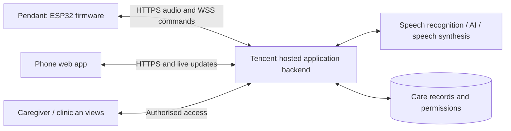

# CareLoop: product requirements document

Version 0.1 · 22 September 2026 · Proposed MVP specification

**Product:** a voice companion inside a lanyard cardholder for older adults, connected to a phone-friendly care dashboard.

**Ownership:** the supplier assembles and tests the hardware. The project team writes the ESP32 firmware, Tencent-hosted backend, AI integration, and dashboards.

**Status:** this document defines the build. No hardware connection, cloud deployment, battery result, or clinical benefit has been demonstrated yet. Targets below are proposed acceptance criteria, not observed results.

Read alongside [Hardware–software integration](Hardware-Software-Integration.md) and the [Chinese supplier handoff checklist](Supplier-Handoff-Checklist-ZH.md).

## 1. Problem and opportunity

Older adults managing medication may find it difficult to remember their routines, understand instructions, and capture symptoms or questions before appointments. Family caregivers may receive incomplete updates and cannot easily distinguish an unanswered reminder from a reported skipped dose. These are working problem hypotheses based on the user's concept and hackathon brief; interviews have not yet validated their frequency or severity.

CareLoop lets a person speak when a concern occurs, hear a read-back, and save a confirmed record that can be shared with the appropriate supporter. Its defining interaction is **speak → clarify → confirm → record → follow up**.

## 2. Decisions and assumptions

| Item | MVP decision | Basis / remaining uncertainty |
|---|---|---|
| Form | Necklace/cardholder: front card slot, electronics behind, breakaway strap | User requirement; dimensions and weight await supplier |
| Hardware | ESP32-S3, I²S microphone, I²S amplifier, speaker, tactile button, haptic motor and driver, protected rechargeable battery | User's reference component list; final modules and GPIO map must be frozen |
| Processing | Device captures/plays audio; backend interprets it | User requirement |
| Network | Pendant connects over 2.4 GHz Wi-Fi to the project backend hosted on Tencent Cloud | Follows the user's latest Tencent/Wi-Fi specification |
| Phone | Responsive web app, installable as a PWA if useful; reads the same backend | Proposed choice to support phones without a native Bluetooth bridge |
| Phone's role | Dashboard; optionally supplies a Wi-Fi hotspot | Audio does not pass through the phone application in this MVP |
| Audio interaction | Deliberate push-to-talk, short recordings, turn-taking | User requirement; press-and-hold is the initial control mode |
| Initial language | English for the first end-to-end test; language stored per user | Assumption; validate intended users' language before usability testing |
| Cloud location | Prefer Singapore for the application server if available in the team's account | Speech/AI processing locations must be checked separately |
| Data | Fictional profiles and reviewed demonstration medication content during development | Real-user pilot requires separate readiness review |
| Quantity | 1–2 hardware prototypes | Current sourcing plan |
| Deadline | Not supplied; milestone plan rather than a promised delivery date | Owner: project team |

The ESP32-S3 supports BLE but not Classic Bluetooth. The current plan therefore uses Wi-Fi for audio; a future phone-as-audio-gateway design needs a separate native-app transport decision. [Espressif Bluetooth documentation](https://docs.espressif.com/projects/esp-idf/en/latest/esp32s3/api-guides/ble/overview.html)

## 3. Goals and measurement

Targets are hypotheses to use during testing, not claims about treatment effectiveness.

| Goal | Measure | Initial success target |
|---|---|---|
| Make a health note without navigating an app | Moderated test: report a symptom, correct one detail, confirm | At least 4 of 5 intended users complete it with no facilitator action after onboarding |
| Preserve medication reporting accurately | Scripted tests covering taken, skipped, ambiguous, and no response | 100% of the scripted cases retain the correct reporting state; no inferred ingestion |
| Provide responsive interaction | Instrumented trials with clips ≤10 seconds on the agreed demo network | Local recording feedback within 300 ms; p95 release-to-reply audio ≤8 seconds across 30 trials |
| Make confirmed information available promptly | Time from database commit to an open authorised dashboard | p95 ≤2 seconds across 30 events |
| Sustain useful wear during a demo | One-hour run with Wi-Fi connected, 20 turns, and 3 reminders | No reset or audio/power failure; report measured battery consumption |

For a later 14-day formative pilot, proposed lagging targets are: 60% of enrolled users use the core flow on at least 8 days, and 80% of shared requests are acknowledged within the individual caregiver's agreed response window. Set a baseline first; these are engagement measures, not evidence of improved health or medication adherence. Measure caregiver workload and unwanted alerts alongside usage.

## 4. Users and stories

| Persona | User story |
|---|---|
| Older adult | As an older adult, I want to report a concern by speaking so that I do not need to remember it until an appointment. |
| Older adult | As an older adult, I want to hear and correct the device's interpretation so that my record reflects what I meant. |
| Older adult | As an older adult, I want medication reminders and a readable history of what I reported so that I can check my routine. |
| Older adult | As an older adult, I want explanations tied to my recorded instructions so that unfamiliar medication terms are easier to understand. |
| Older adult | As an older adult, I want to know when a message failed so that I can use another way to get help. |
| Older adult | As an older adult, I want control over sharing so that personal conversations do not automatically become family updates. |
| Family caregiver | As a caregiver, I want a short list of unresolved requests and reported difficulties so that I know what requires follow-up. |
| Clinician | As a clinician reviewing an appointment report, I want the original reports, dates, and uncertainty behind a summary so that I can assess it. |
| Project developer | As the software developer, I want the exact pin map and hardware diagnostics so that I can develop firmware independently of the supplier. |

## 5. MVP requirements

P0 is required for the scoped demonstration. Acceptance tests use fictional data unless otherwise stated.

| ID | Priority | Requirement | Acceptance criteria |
|---|---|---|---|
| R01 | P0 | Associate one device with one patient profile | A signed-in owner claims a device using a one-use possession code. A second account cannot claim it. Revocation stops device access. The backend derives patient identity from the authorised binding. |
| R02 | P0 | Capture deliberate voice input | Holding the button starts recording after a short haptic cue; release stops it. Recording is capped at 20 seconds. The microphone is inactive during idle and response playback. A short accidental press creates no care record. |
| R03 | P0 | Speak back and confirm health notes | Given a symptom report, the system asks only for necessary missing details, reads back a draft, and saves a confirmed note only after an explicit response. Unstated fields remain unknown. A correction produces a revised draft before confirmation. |
| R04 | P0 | Maintain a checked medication plan | The owner/caregiver enters name, instructions, schedule, timezone, and source. Activation requires checking against the current prescription/label. Editing creates a new version and cancels queued reminders from the previous version. |
| R05 | P0 | Deliver scheduled reminders while connected | A due reminder is queued, delivered, and acknowledged as playback completed separately. In a healthy connected idle device, playback starts within 10 seconds of due time in scripted tests. Expired reminders do not play after reconnection. |
| R06 | P0 | Record medication use as a report | Taken, skipped, not-yet, uncertain, and no-response test cases have distinct outcomes. Ambiguous medicine/time references prompt clarification. Reminder delivery never sets a dose to taken. Silence leaves the dose unconfirmed. |
| R07 | P0 | Explain known medication instructions | Responses use the active medication record and reviewed reference text, with source/version visible in the app. Unknown medicines and treatment-change questions produce a request to consult the relevant professional. The system does not generate replacement doses or missed-dose instructions. |
| R08 | P0 | Create and acknowledge support requests | A user can confirm a request such as refill assistance, select sharing, and see sent/acknowledged/resolved states. The pendant says the caregiver has seen it only after explicit acknowledgement. Urgent help requests present the configured calling route without implying emergency dispatch. |
| R09 | P0 | Provide the phone and caregiver views | An authorised user can see today's reminders, reported dose states, confirmed notes, request status, device connection and last-seen time. A caregiver sees only information permitted by the patient. Cross-account access tests fail closed. |
| R10 | P0 | Cover preventive care and visit preparation | Store one or more care-plan follow-up dates and generate a user-requested appointment summary. The summary distinguishes observations from interpretations, preserves unconfirmed states, and links to entries. No automatic screening eligibility calculation. |
| R11 | P0 | Be clear about failures and retention | Failed upload plays a local failure prompt and never reports success; a lost acknowledgement is described as receipt unconfirmed until reconciled. One unacknowledged clip can remain temporarily in RAM; it expires after 60 seconds and is lost on power-off. No offline persistence is advertised. Deleting/revoking a shared note removes it from future dashboard reads and summaries. |
| R12 | P0 | Provide a respectful companion experience | Use the chosen name, language, short sentences, and one question at a time. Include a greeting and optional daily check-in. Casual conversation creates no clinical note or shared event without confirmation and permission. |
| R13 | P1 | Reduce interaction effort | Add a tap-to-start/tap-to-stop mode and repeat control after testing button usability; each mode has a distinct recording indication and an inactivity limit. |
| R14 | P1 | Extend companionship and language support | Add selected interests, family voice messages, and a second language. Each is opt-in and tested with intended accents; private memory is separable from care records. |
| R15 | P1 | Support stronger offline and battery behaviour | Add an encrypted pending queue and versioned local reminders only after power measurement and stale-schedule rules are agreed. Offline states are visible and conflicts never change treatment instructions automatically. |
| R16 | P2 | Expand hardware and clinical integrations | Explore phone relay, Bluetooth measurement imports, native push notifications, and clinical-system connections only after interoperability and workflow validation. |

## 6. Scope boundaries

The MVP does not diagnose symptoms, recommend treatment changes, infer that medication was swallowed, or measure vital signs. It does not provide fall detection, continuous listening, or a monitored emergency service. These capabilities would require different evidence, hardware, or operating arrangements.

All-day battery life, waterproofing, a custom PCB, and commercial-product readiness are future engineering outcomes. A read-only appointment report is the first clinician interface; an actively staffed clinician alert dashboard is outside the initial release.

## 7. Core journeys

**Medication:** checked plan → scheduled dose instance → reminder command → device playback acknowledgement → user response → explicit clarification/read-back where required → user-reported state. Delivery and reporting are separate records.

**Health note:** push-to-talk → transcript → draft details → spoken read-back → explicit confirmation → private care note → optional permitted sharing → appointment summary.

**Support request:** spoken request → read-back with recipient → confirmation → shared task → caregiver acknowledges → user can hear that acknowledgement → task resolved with a human-entered outcome.

**Medication explanation:** identify medicine from the active plan → retrieve approved information → brief sourced explanation. If identity or instructions are uncertain, ask a clarifying question or direct the question to a pharmacist/clinician.

**Failure:** connection unavailable → local failure indication → no fabricated success → phone/calling alternative. A connected status measures device reachability, not the patient's wellbeing.

## 8. Screens and information structure

| Screen | Essential content |
|---|---|
| Setup | Patient profile, language, timezone, consent, device claim, network status, checked medication plan |
| Today | Next reminders, recent self-reports, unconfirmed items, device last seen |
| Health timeline | Confirmed notes, user wording, occurrence time versus entry time, corrections, sharing state |
| Caregiver tasks | New/acknowledged/resolved requests with recipient and timestamps |
| Medication details | Source instructions, active version, dose history, clarification questions |
| Visit summary | Chosen time range, reported patterns, medication concerns, outstanding questions, links to source entries |
| Settings | Access grants, retention controls, preferred name/language, device revoke/reset, connection help |

Use large controls and readable text, explicit labels in addition to colour, adjustable audio, and captions. The pendant should not require reading a screen to complete a turn. Haptics complement audio; they do not guarantee accessibility for every user.

## 9. Data and permissions

The principal records are Patient, User, AccessGrant, Device, MedicationPlanVersion, DoseInstance, ReminderDelivery, VoiceTurn, ConfirmationProposal, HealthNote, SupportRequest, FollowUp, and AuditEvent. Technical identifiers and examples are in the integration document.

Medication source text remains separate from AI summaries. User-confirmed reports retain their original confirmed wording and provenance. Reported symptoms do not become measured medical findings, and apparent associations do not become causal claims.

The patient/authorised owner controls caregiver access. A clinician receives only a deliberately shared, time-limited read-only view for the demo. Caregivers can acknowledge tasks and enter proposed plan changes; AI cannot activate a medication plan. No conversation is routed to a contact simply because the person was mentioned.

Development uses fictional profiles. Raw uploaded audio is transient by default: delete after transcription succeeds or terminal processing failure, with a 24-hour cleanup maximum for abandoned jobs. No raw-audio archive is included in the MVP. Confirmed text and care events remain until owner deletion during the prototype. Before real users, agree retention, backups, data locations, access/revocation and deletion handling with the project owner. Application hosting location alone does not establish where external AI providers process data.

## 10. Architecture and supplier boundary

The diagram reflects the latest requested cloud arrangement. A phone hotspot provides network access; it does not process pendant audio. A phone-only/phone-relay architecture remains a separate future option.

| Work | Supplier | Project team |
|---|---|---|
| Component selection, wiring, charging/protection, enclosure | Build and document | Approve interface and size before assembly |
| Basic hardware diagnostic program | Run; request source and build notes as part of handoff | Reproduce before application development |
| Application firmware and network protocol | No production software responsibility | Own and implement |
| Tencent backend, AI, app and dashboards | No backend credentials or patient data required | Own and implement |
| Acceptance | Show recording/playback, motor, button, charge and power tests | Run complete care flows on received hardware |

## 11. Delivery plan and dependencies

| Stage | Output | Exit condition |
|---|---|---|
| A. Freeze interfaces, before assembly | Exact board/BOM, GPIO map, power diagram, USB access, acoustic layout | Supplier answers the handoff checklist; incompatible parts resolved |
| B. Software with a simulated pendant, while hardware is built | Browser/laptop audio client using the same device API with test-only credentials | One voice note can be uploaded, read back, confirmed, and shown in the app |
| C. Hardware bring-up, indicative 1–2 working days | Record/playback, button, haptics, Wi-Fi, valid HTTPS | Test recording is intelligible at intended wearing position; no power reset |
| D. Connect the vertical slice, indicative 2–3 working days | Real device note → confirmation → dashboard | Thirty scripted turns pass the defined transport and reporting tests |
| E. Care features, indicative 2–4 working days | Medication flow, explanation content, caregiver tasks, visit summary | P0 acceptance checks pass |
| F. Demo rehearsal and formative usability | Measured latency, power, failure behaviour, user task completion | Known limitations recorded; failures fixed or scope changed explicitly |

These are planning estimates for a developer already comfortable with the stack. Stages overlap; sourcing, supplier delivery, learning embedded development, and revisions can dominate the schedule. No calendar deadline is assumed.

The first implementation milestone is **wear pendant → report a symptom → hear read-back → confirm → see the note on the phone**. Only then add scheduled medication reminders.

## 12. Risks and decisions still needed

| Question / risk | Owner | Blocking point | Next action |
|---|---|---|---|
| Exact ESP32-S3 module, available pins and audio modules | Supplier + firmware developer | Before final assembly / pin-specific code | Freeze BOM and signed-off connection map |
| Low volume or clothing noise at chest height | Supplier + UX | Before enclosure freeze | Record and play speech in the actual holder with card inserted |
| 500 mAh versus connected reminder availability | Firmware developer | Before any all-day claim | Measure active/idle current and reminder latency; choose duty cycle |
| Tencent account, region, ASR/TTS/LLM access and credentials | Backend developer | Before live AI integration | Test one synthetic sentence through the chosen provider adapters |
| User language and preferred button behaviour | Product / UX | Before user testing | Confirm with intended users; make defaults explicit |
| Phone platform / hotspot behaviour | App developer | Before mobile rehearsal | Test actual phones and 2.4 GHz connectivity |
| Deadline, team skills and budget | Project owner | Before scheduling commitments | Map stages to available people and received-hardware date |
| Reviewed medication content and help-routing wording | Product + clinical adviser | Before real care use | Review fixed content and escalation wording; no improvised dosing logic |
| Real-user consent, retention and provider processing locations | Project owner | Before a real-user pilot | Record data flow and access decisions; remove test accounts and secrets |

## 13. Definition of done

- Supplier handoff is complete and the received hardware passes the bench checklist.
- All P0 requirements pass on the actual target board and demonstration network, including disconnect, retry, stale reminder, and ambiguous-dose cases.
- Firmware, API and app builds are reproducible; secrets are outside source control.
- Demonstration data is fictional; shared access is explicit and revocable.
- Battery runtime and acoustic performance are reported as measurements with conditions.
- The team can run the core flow from a fresh device setup, and explain the current offline and emergency-service limits accurately.

## 14. Evidence and reference notes

The product assumptions come from the user's supplied hackathon images and subsequent conversation, not completed user research. Engineering recommendations are proposed design decisions. Manufacturer references support capability checks, not proof that the complete prototype works:

- ESP32-S3 I²S input/output capability: [Espressif I²S documentation](https://docs.espressif.com/projects/esp-idf/en/latest/esp32s3/api-reference/peripherals/i2s.html).
- BLE/Classic Bluetooth distinction: [Espressif Bluetooth overview](https://docs.espressif.com/projects/esp-idf/en/latest/esp32s3/api-guides/ble/overview.html).
- Secure WebSocket implementation starting point: [Espressif WebSocket client](https://github.com/espressif/esp-protocols/blob/master/components/esp_websocket_client/README.md).
- Reviewed medication-management principles: [National Institute on Aging](https://www.nia.nih.gov/health/medicines-and-medication-management/taking-medicines-safely-you-age).

References checked during preparation on 22 September 2026; verify service availability in the project's actual cloud account.
