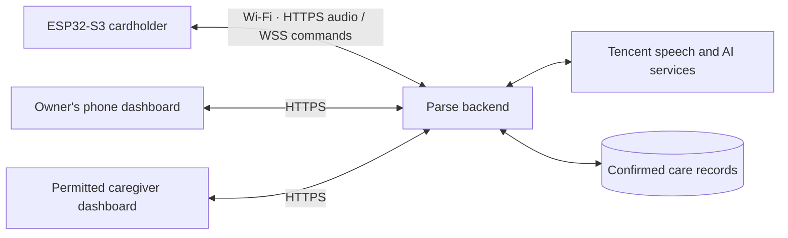

# Parse: connect the first physical cardholder

The software now includes guided pairing, per-device setup files, authenticated audio and command transport, live connection status, revocation, and a deployment connection check. A local software test has exercised the journey from a simulated pendant through confirmation to an automatically refreshed caregiver dashboard. Physical operation and live speech remain to be checked with the assembled board and configured cloud services.

## The connection you are building



The phone can provide a hotspot. The implemented connection does not relay audio through Bluetooth or require the phone browser to remain open. An open dashboard refreshes approximately once a second; a closed browser is not a guaranteed notification channel. Notes reach a caregiver only after confirmation and permission to share.

## 1. What to get from the supplier

Send the supplier the [Chinese hardware brief](Supplier-Handoff-Checklist-ZH.md). Ask for one bench-tested unit before committing to a batch, with:

- The exact ESP32-S3 board/module revision, flash capacity, PSRAM capacity and PSRAM mode. Prefer 8 MB PSRAM for this prototype; external PSRAM must be enabled in the final firmware configuration for the recording buffer.
- An INMP441-compatible I²S microphone, MAX98357A-compatible I²S amplifier and matched speaker, talk button, vibration motor **with a driver**, battery, charger, protection and suitable voltage regulation. The power design must support Wi-Fi and speaker current peaks.
- A signed-off GPIO wiring table, microphone channel selection, amplifier gain/enable behavior and button/motor polarity. The repository deliberately leaves supplier-dependent GPIOs unassigned.
- USB data access plus a documented boot/reset procedure, a 3D-printed cardholder with accessible ports and sound openings, and the hardware diagnostic source code.
- Actual recording/playback, charging, power and card-reader interference results. A 500 mAh label does not establish all-day battery life.

The supplier builds and tests the electronics. You retain the Parse application firmware, dashboard, backend and cloud accounts. Tencent account credentials never go on the pendant.

## 2. Prepare the server once

Follow [deployment setup](../../deploy/README.md) and [provider configuration](PROVIDERS.md). You need a reachable HTTPS hostname with a valid certificate, the Parse backend/database, and a working ASR/LLM/TTS account configuration. The supplied Compose stack sets `CARELOOP_PUBLIC_BASE_URL` from `CARELOOP_DOMAIN` so Settings displays the same address the pendant uses.

Create an owner and their care space using the administrator CLI. Create the intended caregiver and grant access. Pairing commands must run against **this same server database**; creating a credential in an unrelated local SQLite file will not authorize a device on your deployed server.

Keep one backend process for the current prototype. Its live socket registry is in memory and its scheduler runs in that process. Public Docker deployment and live provider access have not been exercised in this workspace.

## 3. Prepare a private setup pack for each pendant

On the backend host, from `backend/`, with the deployment database configured:

```sh
CARELOOP_ADMIN_ENABLED=true .venv/bin/python -m app.admin prepare-device \
  --backend-url https://YOUR-ACTUAL-DOMAIN \
  --output-dir /PRIVATE/NEW-DIRECTORY/pendant-001 \
  --claim-minutes 60
```

Replace the illustrative hostname and directory. The directory must be new. The command creates an unclaimed device, stores only credential/code hashes in the database, and writes a private directory (0700) containing:

| File | Who needs it | Contents |
|---|---|---|
| `device-nvs.csv` | You / trusted person flashing this unit | Its unique device credential, setup-network password and service address |
| `owner-setup.txt` | Owner or person helping them | One-use pairing code, expiry, setup Wi-Fi password and connection steps |
| `device.json` | Hardware developer | Device ID, NVS layout and non-secret manufacturing metadata |

The credential is not printed. Keep each unit's pack separate and private; do not add it to Git or reuse it on another unit. NVS stores this prototype's credential on the device; physical flash security is a separate production-hardening task.

For the provided Docker deployment, create the pack inside the backend container and copy it to your private workstation folder:

```sh
docker compose --env-file deploy/.env exec -e CARELOOP_ADMIN_ENABLED=true backend \
  python -m app.admin prepare-device --backend-url https://YOUR-ACTUAL-DOMAIN \
  --output-dir /tmp/pendant-001 --claim-minutes 60
docker compose --env-file deploy/.env cp backend:/tmp/pendant-001 /PRIVATE/NEW-DIRECTORY/pendant-001
```

The claim code expires after one hour by default. If shipping takes longer, issue a fresh code when the owner is ready. This preserves the flashed device credential and invalidates the old code:

```sh
CARELOOP_ADMIN_ENABLED=true .venv/bin/python -m app.admin renew-claim \
  --device-id DEVICE-ID-FROM-THE-PACK --claim-minutes 60
```

Run that command against the same backend database. It only works for an unclaimed, unrevoked device. A revoked unit needs a new setup pack and credential before it can reconnect.

## 4. Build and flash the supplier's exact board

Use [ESP-IDF v5.4.2 and the firmware instructions](../../firmware/README.md). Configure the verified GPIO map, flash layout and actual PSRAM type through `idf.py menuconfig`. The default compiled image intentionally has inert pins and is **not** a ready-to-flash image for an unknown board.

After building and flashing the application, generate the private NVS partition. From the repository root with the ESP-IDF environment activated:

```sh
umask 077
python "$IDF_PATH/components/nvs_flash/nvs_partition_generator/nvs_partition_gen.py" generate \
  /PRIVATE/pendant-001/device-nvs.csv /PRIVATE/pendant-001/device-nvs.bin 0x6000
python "$IDF_PATH/components/partition_table/parttool.py" --port YOUR-USB-PORT \
  write_partition --partition-name nvs --input /PRIVATE/pendant-001/device-nvs.bin
```

This matches the repository's `nvs` partition size of `0x6000`. Recheck the actual partition table if the supplier changes it. The generated CSV was successfully accepted by Espressif's matching NVS generator in the local software test. See the [official NVS generator documentation](https://docs.espressif.com/projects/esp-idf/en/v5.4.2/esp32s3/api-reference/storage/nvs_partition_gen.html).

Write this NVS file during initial provisioning. Rewriting it later replaces saved Wi-Fi settings and the reminder replay ledger. Use the Wi-Fi reset below for ordinary network changes.

## 5. Pair and connect

1. Sign in as the care-space owner. Open **Settings → Pair your cardholder**, enter the one-use code and select **Pair cardholder**. “Paired · waiting for connection” means the account binding succeeded; it is not yet proof of connectivity.
2. Power on the pendant. Join its `CareLoop-XXXX` setup Wi-Fi using the password on the private owner sheet. `CareLoop` remains the firmware's setup-network name for compatibility; the product is Parse.
3. While joined to that network, open `http://192.168.4.1/`. Enter the 2.4 GHz WPA2 Wi-Fi/hotspot details and the actual HTTPS service address. The password-protected setup network expires after ten minutes; restart the unit to reopen an unfinished setup.
4. Rejoin your usual phone network and open Parse. Look for **Online**. This requires an authenticated socket with a heartbeat in the last 15 seconds; it does not establish microphone or speaker quality.
5. To change Wi-Fi later, hold the talk button while powering on and keep holding for five seconds. After two vibration pulses, release it and repeat Wi-Fi setup. This clears only the saved Wi-Fi details and preserves the device credential, service address, setup password and reminder ledger. This firmware behavior compiles but still needs a physical button/power-cycle check on the delivered board.

## 6. Check the deployment connection

From the repository root, using this unit's private setup pack:

```sh
backend/.venv/bin/python tools/check_hardware_ready.py \
  --base-url https://YOUR-ACTUAL-DOMAIN \
  --nvs-file /PRIVATE/pendant-001/device-nvs.csv \
  --require-voice-config
```

The check verifies HTTPS access, the bound device identity, audio protocol, reminder reconciliation and an authenticated WSS heartbeat. It refuses redirects, does not print the credential, and does not record audio or create care records. It briefly creates its own diagnostic connection, so its heartbeat is not proof that a physical pendant is online. Disconnect the checker and observe heartbeats from the actual unit.

Exit 0 means the requested checks pass; 1 means transport/configuration failed; 2 means transport works but the requested public-address, voice-configuration or scheduler requirements remain incomplete. “Configured” checks environment configuration, not successful paid-provider calls. The report always leaves physical hardware unverified.

## 7. First physical acceptance test

The [first-use handoff guide](First-Use-Guide.md) explains the owner and caregiver checks across Parse's device options. For this cardholder, use its physical talk button and speaker, verify the current network connection, and check the confirmed shared record through the caregiver's own account. Browser or simulated speech checks do not establish physical operation.

Use fictional information for the first run:

1. Press and hold the talk button, say a short note and release it. Hear the response through the pendant speaker.
2. Listen to the read-back, correct it if needed, and explicitly confirm. Check that exactly one saved timeline entry appears. A transcription or reminder receipt alone must not create a confirmed care fact.
3. Explicitly share the note with the chosen caregiver. Keep their dashboard open and confirm it appears automatically; another caregiver without that sharing permission must not see it.
4. Enter a checked fictional medication plan and test one reminder. Playback should update its delivery status; medication remains unconfirmed until an explicit report is confirmed.
5. Turn off Wi-Fi, reconnect, change the Wi-Fi via the boot gesture, restart during a response and test revocation with a disposable unit. Verify accurate offline/unknown states and no duplicate note or stale reminder replay.
6. Measure chest-level intelligibility, audio latency, runtime, temperature and current peaks with the card installed. Record the actual board/pin configuration used.

The immediate information still needed is your **exact board model/pin map** and **deployment hostname/provider setup**. These determine the final firmware configuration and live acceptance run; they cannot be inferred from “ESP32-S3.”
