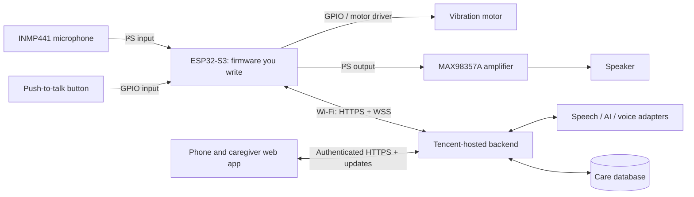

# CareLoop: connecting the physical wearable to the software

Version 0.4 · 23 September 2026 · Engineering contract and implementation boundary

This specification accompanies the [PRD](CareLoop-PRD.md). The repository now contains firmware, backend and dashboard implementations; the assembled hardware connection and live cloud operation remain unverified. See [verification status](VERIFICATION.md) and the [implemented API contract](../../backend/API.md). All hostnames ending in `.example` and identifiers below are illustrative.

## 1. Recommended connection

Use **HTTPS for complete audio clips and acknowledgements**, plus a **secure WebSocket (WSS) for commands and status**. The ESP32 makes outbound connections to the backend. The phone opens a web dashboard against that backend; it does not need a Bluetooth audio connection.

The ESP32-S3 pendant is the voice prototype from the start. A phone voice prototype is outside scope. Developer test fixtures can exercise the backend before hardware arrives, but the product voice flow and its acceptance tests run on the actual pendant.



A phone hotspot can supply internet access, but is only a network connection in this design. BLE provisioning can be added later. The ESP32-S3 does not support Classic Bluetooth headset mode; do not treat it as a plug-and-play phone headset. [Espressif Bluetooth overview](https://docs.espressif.com/projects/esp-idf/en/latest/esp32s3/api-guides/ble/overview.html)

### Why upload a clip first?

Push-to-talk naturally creates a short complete recording. Capturing up to 20 seconds and uploading it on release avoids live-stream pacing, codec negotiation and echo cancellation in the first build. Responses play after recording stops. This is a proposed engineering simplification; measure latency and memory on the selected board.

## 2. What must be handed over by the hardware supplier

The supplier owns assembly, enclosure, power design and basic hardware tests. You own application firmware and everything above it. Obtain the following before accepting the assembled unit:

| Required handoff | What it must specify |
|---|---|
| Exact BOM | Board SKU/revision, ESP32-S3 variant, flash/PSRAM, microphone module, amplifier, speaker impedance/power, motor/driver, battery/protection, charger and regulator |
| Connection map | Every module terminal → board GPIO or power rail; pin labels alone are insufficient without board revision |
| Power diagram | USB input, charger, battery protection, load sharing if used, regulator rails, main switch, common ground, and voltage measurement circuit |
| Development access | Working USB data/programming port, boot/reset access and the procedure for recovery flashing |
| Diagnostics | Source, dependencies, build/flash instructions and video for recording, playback, button, haptic, Wi-Fi, battery and charging tests |
| Mechanics | Editable enclosure file, printable file, mounting method, microphone/speaker openings, card dimensions, strap release mechanism |

Ask for an ESP32-S3 board with external PSRAM; 8 MB is the preferred reference configuration for development headroom. Availability and selected SKU remain supplier decisions to confirm. A 20-second clip alone needs approximately 640 kB before networking and other buffers.

## 3. Physical electrical interface

**Do not wire from an assumed GPIO numbering scheme.** The exact board has not been selected. The table below is the connection contract the supplier must fill in, not a final pin assignment.

| Component terminal / function | ESP32 logical connection | Supplier must confirm |
|---|---|---|
| Microphone SCK/BCLK | `MIC_BCLK` I²S clock output | Available GPIO, signal integrity and board conflicts |
| Microphone WS/LRCLK | `MIC_WS` I²S word-select output | Available GPIO and expected slot format |
| Microphone SD | `MIC_DATA_IN` I²S data input | Correct channel selection and sample alignment |
| Microphone L/R | Fixed channel selection | Tie to the documented rail; firmware must read that channel |
| Amplifier BCLK / LRC | `SPK_BCLK` / `SPK_WS` I²S clock outputs | Separate RX/TX clock pins preferred for the first modular build |
| Amplifier DIN | `SPK_DATA_OUT` | Audio format, channel selection and gain configuration |
| Amplifier enable/shutdown, if exposed | `AMP_ENABLE` | Correct active level; disable during recording/idle |
| Speaker terminals | Amplifier differential output terminals | Speaker impedance and power match; neither output treated as ground |
| Push-to-talk button | `PTT_INPUT` plus ground, with suitable pull-up | Polarity, debounce, usable placement and no boot-pin conflict |
| ERM vibration motor | Rated motor driver; ESP controls `HAPTIC_ENABLE` | Driver, appropriate inductive protection and motor voltage; no direct GPIO motor load |
| Battery voltage/status | `BATTERY_SENSE` or fuel-gauge interface | Divider, ADC range/calibration, charging indication |
| Power / USB | Board-specific power inputs and programming connection | Avoid conflicting power paths; retain USB data and recovery access |

The ESP32-S3 has I²S peripherals for digital audio input/output. INMP441 delivers digital microphone samples, and MAX98357A accepts digital audio to drive a speaker. These capabilities establish compatible building blocks, not a guarantee of a quiet assembled device. [Espressif I²S](https://docs.espressif.com/projects/esp-idf/en/latest/esp32s3/api-reference/peripherals/i2s.html), [INMP441 datasheet](https://invensense.tdk.com/wp-content/uploads/2015/02/INMP441.pdf), [MAX98357A](https://www.analog.com/en/products/max98357a.html)

For power, the supplier must provide a regulated rail appropriate to the ESP32 board and microphone, plus correctly rated amplifier/motor rails and decoupling. Do not connect a raw LiPo to an assumed 3.3 V pin. A TP4056 reference module does not by itself specify the complete system protection or load-sharing design. Charging while operating requires an explicitly designed power path. [Microchip load-sharing reference](https://www.microchip.com/en-us/application-notes/an1149)

## 4. Firmware responsibilities

Use ESP-IDF with the manufacturer's working audio diagnostics as the starting point. Pin the framework and component versions only after that example compiles and passes on the delivered board. Keep the supplier's pin map in one board configuration file.

| Firmware module | Responsibility |
|---|---|
| Board / power | GPIO map, safe startup levels, amplifier control, battery status |
| Audio capture | I²S RX, correct signed sample conversion, clipping detection, fixed maximum recording size |
| Audio playback | Parse supported WAV format, feed I²S TX, volume limit, local prompts |
| Interaction | Button debounce, haptic timing, state machine, recording limit |
| Connectivity | Wi-Fi, TLS validation, HTTPS upload, WSS commands, reconnect/backoff |
| Protocol | Device identity, message IDs, acknowledgements, expiry checks, duplicate suppression |
| Diagnostics | Battery millivolts, Wi-Fi strength, reset reason, last error; no raw health content in routine logs |

The ESP-IDF HTTPS client and managed WebSocket client provide implementation starting points. Validate certificates and hostname; do not ship code that disables verification. [ESP HTTPS client](https://docs.espressif.com/projects/esp-idf/en/latest/esp32s3/api-reference/protocols/esp_http_client.html), [Espressif WebSocket component](https://github.com/espressif/esp-protocols/blob/master/components/esp_websocket_client/README.md)

### State and feedback

`BOOT → CONNECTING → IDLE → RECORDING → UPLOADING → WAITING → PLAYING → IDLE`

`OFFLINE`, `LOW_BATTERY`, and `ERROR` are explicitly displayed/reported; device connectivity does not indicate patient condition.

- Initial button mode: hold to record, release to finish. Start after a 100 ms haptic cue and a short settling interval; a release before capture begins cancels the attempt. Debounce initially at 40 ms and tune against the real switch.
- Cap recordings at 20 seconds. A sub-300 ms captured clip is treated as an accidental press and is not interpreted as care input.
- Disable the amplifier during capture and disable microphone capture during playback. Do not record the device's own reminder as the user's answer.
- Button press during playback stops playback; report `interrupted` and start a new deliberate capture after the start cue. It is never automatically a confirmation.
- Avoid motor movement during active recording. Store local fixed audio for “not connected,” “not sent,” “I cannot confirm whether that was received,” and low-battery feedback.
- After a response asks a question, retain its server-issued context ID for the next deliberate turn. The microphone still remains off until the button is pressed.

## 5. Audio format and memory budget

| Parameter | Proposed contract |
|---|---|
| Transport audio | RIFF/WAV, signed 16-bit little-endian PCM, mono, 16,000 samples/second |
| Input duration | 0.3–20 seconds |
| Raw payload rate | 16,000 × 2 × 1 = 32,000 bytes/second |
| Maximum basic WAV | 640,000 PCM bytes + 44-byte basic header = 640,044 bytes |
| HTTP upload size cap | 768 KiB, with separate parsed duration/format checks |
| Reply audio | Same format; each clip ≤20 seconds; ordered `audio_paths` supports up to 20 clips and 120 seconds total, with `audio_path` retained as a single-clip fallback |
| Pending capacity | One unacknowledged clip in RAM; do not overwrite silently |

The INMP441's hardware sample width/slot layout differs from the wire format. Firmware must correctly sign-extend/scale the selected I²S channel into 16-bit samples. Verify using a known voice recording; declaring a WAV header does not convert sample data.

Upload and playback are sequential. Reuse buffers where possible; do not allocate simultaneous full-size input/output clips without measuring headroom. Report free heap/PSRAM under TLS load. Start with uncompressed WAV; compression is a later bandwidth/power optimisation.

## 6. Backend and phone stack

Proposed stack: **ESP-IDF firmware; Python/FastAPI backend; PostgreSQL; React/TypeScript responsive web app**. Alternatives are fine if they preserve the protocol and acceptance checks. FastAPI supports WebSocket endpoints. [FastAPI documentation](https://fastapi.tiangolo.com/advanced/websockets/)

Deploy the application on a Tencent Cloud VM/container host capable of long-lived WSS connections. Expose an owned domain over HTTPS/WSS on port 443. Configure WebSocket upgrade handling and idle timeouts at any proxy/load balancer. The account, domain, provider access and hosting location are not yet provisioned.

For the first demo, use one backend instance and a database-backed scheduler/outbox. A transient socket registry can be in process, but reminders and care events must survive an application restart. Multi-instance routing requires a shared message layer later. Start with 5-second heartbeats and mark a device stale after 15 seconds without a heartbeat; measure the power cost before adopting those defaults outside the demo.

Separate backend adapters: `transcribe_audio`, `interpret_turn`, `retrieve_medication_info`, and `synthesise_speech`. Tencent hosting does not require committing to a single AI provider. Provider keys and Tencent account secrets remain server-side.

Tencent's documented short-utterance recognition API is a candidate for complete clips; verify account/region access and language before adopting it. Its real-time API has pacing constraints and should not receive a completed WAV burst as if it were live audio. If only a streaming API is available, add an explicit paced streaming adapter or choose a supported clip API and remeasure latency. [Tencent short-utterance API](https://cloud.tencent.com/document/api/1093/35646), [Tencent real-time API](https://www.tencentcloud.com/document/product/1118/53937)

## 7. Setup, authentication and ownership

For bench work with fictional data, the developer can configure Wi-Fi and the application endpoint through a USB setup tool; values must stay outside the shared repository. For the user-facing MVP, provide a temporary password-protected setup access point with a per-device password and a setup timeout. The caregiver enters home Wi-Fi details in a local page. Turn setup mode off once complete; provide a physical reset procedure. Validate the flow on the actual phone, including its temporary loss of internet access.

After Wi-Fi setup:

1. The project team installs a unique, revocable device credential through the development interface. It is not a Tencent API key. Do not give the hardware supplier a live cloud account secret.
2. The owner signs in to the web app and uses a short-lived, one-use possession code associated with that device. Server-side claim logic is rate limited.
3. The server binds the device to the patient account and derives all patient access from that binding. A client-supplied `patient_id` cannot change it.
4. HTTPS/WSS calls authenticate using the device credential; dashboard calls use a separate human-user session with access grants.
5. Revocation immediately rejects new requests and closes its active socket. Reset/reassignment requires deleting prior credentials and care context.

Time is synchronised before certificate and command-expiry checks. Device-supplied occurrence times are advisory; always store server receipt time too. If time is invalid, do not play time-sensitive medication commands.

For a real-user pilot, harden credential storage, secure update/recovery, rate limits and data-retention handling. Initial USB flashing is sufficient for the demo; unattended OTA is outside P0.

## 8. Device API contract

These are proposed application endpoints, not Tencent product endpoints. Device credentials only authorise access to that device's own records/assets.

| Method / path | Purpose | Required behaviour |
|---|---|---|
| `POST /v1/device/turns` | Upload a complete WAV | Authenticated; idempotency key and format checks; persist before acknowledging |
| `GET /v1/device/turns/{turn_id}` | Recover status/result after socket loss | Same device only; no need to re-upload an accepted clip |
| `GET /v1/device/audio/{asset_id}` | Fetch response or reminder WAV | Authenticated; bounded size/duration; expiry and ownership checked |
| `WSS /v1/device/events` | Receive results, reminders and request updates | Authenticate handshake; server-issued events with expiry; heartbeat |
| `POST /v1/device/acks` | Report command receipt/playback | Idempotent; received, started, completed, interrupted, failed remain separate |
| `GET /v1/device/pending-commands` | Reconcile after reconnect | Return only authorised, unexpired commands with current plan version |

Example upload metadata: `Authorization: Bearer <device credential>`, `Content-Type: audio/wav`, `Idempotency-Key: <unique turn UUID>`, `X-Context-Id: <optional server-issued conversation context>`. The body is the WAV bytes. No credential is placed in a URL or ordinary log.

Device JSON envelopes are bounded to 16 KiB. Firmware must reassemble transport fragments before parsing, reject oversized messages, reject redirects, and validate the asset path and expiry before playback. Reply clips play in order while microphone capture remains stopped; a push-to-talk interruption cancels the remaining clips.

The implemented optional daily greeting uses `checkin.play`, with `command_id`, `context_id`, `audio_paths`, expiry and the same delivery acknowledgements. It is distinct from a medication reminder and never constitutes a health observation. `/v1/device/pending-commands` reconciles both `commands` and `checkins`. The owner configures the local check-in time and can disable it.

The upload response means the server durably accepted the audio; it does not mean a clinical note was confirmed:

```json
{
  "turn_id": "turn_demo_001",
  "status": "accepted",
  "received_at": "2026-09-22T12:00:00Z"
}
```

Server processing creates a proposal and sends a result event. The reference clock values are examples only:

```json
{
  "protocol_version": 1,
  "event_id": "evt_demo_001",
  "type": "turn.result",
  "device_id": "device_demo_001",
  "server_time": "2026-09-22T12:00:03Z",
  "expires_at": "2026-09-22T12:02:03Z",
  "payload": {
    "turn_id": "turn_demo_001",
    "context_id": "context_demo_001",
    "status": "awaiting_confirmation",
    "spoken_text": "I will record left-knee pain after your walk today. Is that right?",
    "audio_path": "/v1/device/audio/audio_demo_001"
  }
}
```

The user holds the button and answers. The new upload carries `X-Context-Id: context_demo_001`. The backend checks ownership, expiry and the exact pending proposal before committing. A context lasts 120 seconds in the initial demo; ambiguous or late replies trigger clarification. The proposal can also be reviewed and explicitly confirmed in the authorised dashboard. The LLM cannot commit directly to the database.

The same proposal/read-back/confirmation path applies to health notes, medication reports, measurements, preventive-task changes and support requests (PRD R19). Read back the material fields before requesting confirmation. A correction creates a new immutable proposal and invalidates the previous context. For medication reports, recheck the referenced plan version before commitment; a changed plan requires reconciliation and clarification. A delivery acknowledgement, a dismissed reminder or an unrelated yes is never a confirmation.

Only after the transaction commits may a `turn.result` expose `status: committed` with the committed record type and ID and play a saved response. Before that, audio `accepted` and proposal `awaiting_confirmation` remain distinct. Persist the outcome with the proposal so retry/status lookup returns the same record. System delivery states and date-derived due status can update automatically; they cannot establish patient completion.

### Retry and acknowledgement rules

- Use a UUID generated once per capture as the idempotency key. Same key plus same content returns the existing turn; different content under the same key returns conflict. Backend-generated readable IDs in examples do not replace that UUID.
- If the connection drops after upload, query the accepted turn or retry with the same key. Never create a second medication report just because a response was lost.
- Retry transient failures with bounded backoff (initially 1, 2, 4, 8 seconds plus jitter). Honour server retry instructions. Authentication errors require reconfiguration, not an endless retry loop.
- Keep at most one unacknowledged clip in RAM for 60 seconds. Announce “not sent” only when no upload could have reached the server; after an interrupted upload with a lost acknowledgement, say receipt is unconfirmed until reconciliation succeeds. Reboot or expiry loses the local clip; no durable offline record is promised. Once accepted, release the local audio buffer and recover the result using its ID.
- Validate actual WAV contents; reject invalid format/duration, oversized input, unknown context and unauthorised device. Suggested HTTP statuses: 400 invalid content, 401 invalid credential, 403 revoked/unbound, 409 idempotency conflict, 413 too large, 429 rate limited, 503 retryable service failure.
- The response audio path is relative to the configured backend. Do not let cloud text redirect the device to arbitrary URLs or change configuration.

## 9. Reminders and medication data

Create a dose instance from a checked medication-plan version using the patient's timezone, then store the due instant in UTC. Plan edits cancel unsent prior-version commands. A reminder is a delivery attempt associated with a dose, not a dosing decision.

```json
{
  "protocol_version": 1,
  "event_id": "evt_reminder_001",
  "type": "reminder.play",
  "device_id": "device_demo_001",
  "server_time": "2026-09-22T12:05:00Z",
  "expires_at": "2026-09-22T12:07:00Z",
  "payload": {
    "command_id": "command_demo_001",
    "dose_instance_id": "dose_demo_001",
    "plan_version": 3,
    "context_id": "context_dose_demo_001",
    "audio_path": "/v1/device/audio/audio_reminder_001"
  }
}
```

The 120-second expiry is a transport/demo policy, **not** a medically safe window for taking a medicine. No missed-dose advice is inferred from it. Cache playback assets only within their command's validity, validate plan version before playback, and interrupt/cancel an invalidated queued command.

When the device is recording or speaking, queue a valid reminder until idle; if it expires first, report expired. Confirmation context for a dose is tied to the identified dose and plan. An unrelated statement or a bare “yes” with several possible contexts cannot mark multiple medicines taken.

Example hardware acknowledgement:

```json
{
  "ack_id": "ack_demo_001",
  "command_id": "command_demo_001",
  "stage": "playback_completed",
  "device_time": "2026-09-22T12:05:06Z"
}
```

Delivery states: `queued → received → playback_started → playback_completed`, with `failed`, `interrupted`, `expired`, and `playback_unknown` where appropriate. Dose reports independently use `unconfirmed`, `reported_taken`, `reported_skipped`, `reported_not_yet`, or `reported_uncertain`.

Persist a small command ledger before playback starts so redelivery does not repeat it automatically. After a reset during playback, its outcome is unknown; do not replay a time-sensitive medication command automatically. A backend restart can resend the same unexpired command ID, which the ledger suppresses. Record true report timestamps and optional user-described taken time separately.

## 10. Data model and AI boundary

| Record | Essential fields |
|---|---|
| Device | ID, owner binding, credential version, firmware version, capabilities, last_seen, voltage/status |
| MedicationPlanVersion | Patient, version, medicines/instructions, schedule/timezone, source, checked_by, checked_at, active |
| DoseInstance | Plan version, medicine reference, scheduled_at, report_state, report_time, user-described taken time |
| ReminderDelivery | Command ID, dose ID, validity, individual acknowledgement timestamps |
| VoiceTurn | Device, idempotency key, capture metadata, received_at, transcript, processing state, context ID |
| ConfirmationProposal | Immutable proposed content, context ID, expiry, originating turn, confirmation turn/result |
| HealthNote | Confirmed user wording, structured fields, occurrence description, provenance, sharing grants, correction history |
| Measurement | Patient, type, named values (systolic/diastolic for the first demo), units, occurrence time/approximation, timezone, source description, reporting actor, source turn, confirmation proposal, correction history |
| PreventiveTask | Patient, type, description, care-plan source, due date/timezone, appointment and completion dates when known, state, confirmed transition history |
| FollowUp | Related care item or support request, agreed check time, permission scope, reported outcome and resolution state |
| VisitSummary | Patient, date range, source record IDs/versions, draft, owner edits, generation time and sharing state |
| SupportRequest | Confirmed request, permitted recipient, created/acknowledged/resolved timestamps, outcome |
| AccessGrant / AuditEvent | Actor, scope, object, permission period and changes |

AI output is an untrusted draft validated against a schema and allowlisted intents. Confirmations, permissions, scheduling and database writes are application logic. Medication explanations retrieve the active source text; uploaded documents and speech cannot override system permissions. Care summaries label observations as reported and link each assertion to entries. Backend services never put a patient's entire record into a prompt merely because it is available.

The phone obtains initial data over authenticated HTTPS, receives event notifications, and refetches affected records. A closed/background browser is not a guaranteed caregiver notification channel in P0. Acknowledgement in the open dashboard is a human action, not a network delivery receipt.

Measurements use confirmed external readings reported by the patient; the pendant is not a measurement sensor. Plot dated values with units and sample count, preserve missing data, and avoid mixing incompatible types or units. One reading is a single observation, not a trend. A correction supersedes the original value and invalidates affected summary drafts.

Preventive tasks originate from the recorded care plan. Supported states are planned, due, arranged, completed, declined and needs-discussion. Due status may follow the recorded date; arranged and completed require explicit human reports and confirmation. Appointment dates are distinct from due dates. The backend does not calculate screening eligibility or book appointments. Summary generation includes current task states, measurements and unresolved follow-ups under the existing access grants.

## 11. Power and mechanical feasibility

500 mAh is a proposed component capacity. Approximate runtime is usable capacity divided by average current; idealised arithmetic gives 5 hours at 100 mA and 20 hours at 25 mA, before reserve and other losses. These are examples, not measured device estimates.

Always-connected Wi-Fi provides timely cloud reminders but costs power. Deep sleep cannot preserve the active WSS session. The first demo keeps the device connected and measures consumption; a later duty-cycled or local-schedule design must define reminder delay, clock reliability and schedule invalidation.

Measure idle-connected current, recording/upload current, playback current at the chosen volume, haptic spikes, and charging temperature. Test simultaneous Wi-Fi and playback for brownouts. Test card reading and Wi-Fi with a real transit card installed; keep antenna, battery and card layout adjustable until tested. All-day wear, enclosure temperature and comfort remain validation items.

## 12. Build and test sequence

| Step | Deliverable | Pass condition |
|---|---|---|
| 1 | Supplier diagnostics on your laptop | Reflash succeeds; mic/speaker/button/motor/power tests reproduce |
| 2 | Local audio loop | A 10-second chest-level recording is intelligible and has correct duration/pitch; no clipping or persistent motor/clothing noise |
| 3 | HTTPS echo endpoint | Upload WAV, return same WAV, play it; no AI involved; valid TLS required |
| 4 | First cloud turn | Transcription → short response → TTS plays within measured target |
| 5 | Confirmed note | A correction and confirmation update exactly one note in the app |
| 6 | Reminder command | Scheduled command plays once, has delivery acknowledgement, and remains medication-unconfirmed until a user report |
| 7 | Fault injection | Disconnect during upload/playback, retry, reboot, invalid credentials, expired reminder and changed plan produce accurate states |
| 8 | Complete care coverage | Correct a reported reading, confirm it, inspect dated history, confirm preventive-task progress and review the resulting visit summary; all six PRD areas pass |
| 9 | Wearable rehearsal | Thirty turns and a one-hour run pass; record power, audio, latency and network conditions |

Before hardware arrives, use a developer API test harness to upload WAV fixtures and receive commands, with separate test-only credentials. This is a backend verification tool, not a phone voice prototype or a product demo. Passing these tests proves backend logic; the pendant must separately pass acoustics, battery, electrical stability and end-to-end voice tests.

## 13. Immediate engineering decisions

1. Ask the supplier to freeze the exact BOM, GPIO map, USB access and power diagram before assembly.
2. Create the backend echo endpoint and a developer API test harness while preparing firmware for the selected ESP32 board.
3. Confirm Tencent account access, a clip-capable transcription provider, TTS output format and an application domain.
4. Bring up microphone and playback independently, then connect the echo round trip.
5. Implement the first confirmed health-note journey before adding the medication scheduler.

No live endpoint or firmware is supplied by this document; implementation and bench validation are the next work stage.
