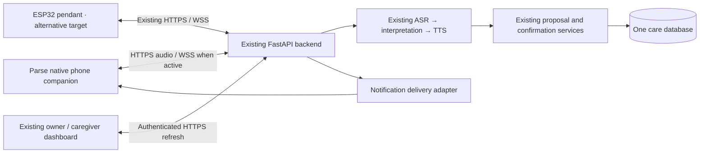

# Parse phone companion — product requirements

Version 1.0 · 27 September 2026 · Ready for implementation; phone functionality is not implemented by this document.

**User request:** Create a phone version that can replace the physical wearable when it is unavailable or fails, with the wearable's functions connected to the existing dashboard. Build on the current platform and hand the implementation to a new task with an active build goal.

**Product decision:** Add a native, installable Parse companion for iPhone and Android, using the phone microphone, speaker, vibration and notifications. Keep the existing React caregiver/owner dashboard and FastAPI care system. The phone connects directly to the same backend over internet access; it does not need an ESP32, Bluetooth relay or a second care database. Both platforms are the working assumption unless the user chooses a narrower target.

## 1. Problem and goals

The project cannot rely on the cardholder being assembled, charged and working during a demonstration. The existing mobile-friendly website is a dashboard: it cannot currently capture the older adult's voice or replace the pendant's playback and reminder behavior. A phone companion makes the complete care journey usable with hardware absent while keeping the same patient, permissions and history.

Goals and proposed acceptance targets:

1. Complete all patient-facing wearable journeys on a phone: conversation, medication reminders/explanations/reports, symptoms, external readings, preventive-care progress, support and follow-ups. No physical pendant is required.
2. Save only confirmed care facts and preserve sharing boundaries. All correction, retry, cross-account and revocation acceptance cases must pass with no duplicate committed records.
3. Make a confirmed shared update appear in an already-open permitted caregiver dashboard without refresh; target p95 ≤2 seconds over 30 events on the documented test network.
4. Start visible recording feedback within 300 ms and target p95 release-to-spoken-response ≤8 seconds for clips ≤10 seconds over 30 live-provider trials. Measure rather than assume these targets are achieved.
5. Switch the active companion between phone and pendant without changing care history or scheduling new medication doses. Demonstrate one hour of phone-only operation with 20 turns, three reminders and a network interruption.

The percentages/timing targets here are evaluation hypotheses, not measured results or clinical-effectiveness claims. A later five-person formative test should aim for four people to complete a corrected note and confirmed medication report after onboarding without facilitator action; track unwanted notifications and caregiver workload as well.

## 2. Authority, baseline and scope

This is an additive product change requested by the user. It **supersedes the phone-voice exclusions** in [CareLoop-PRD.md](CareLoop-PRD.md) §2, R09 and R16, [IMPLEMENTATION-CONTRACT.md](IMPLEMENTATION-CONTRACT.md), and [Hardware-Software-Integration.md](Hardware-Software-Integration.md). Their record-integrity, privacy, medication and physical-device requirements continue to apply. Old phrases such as “the phone remains a dashboard” must not block this build.

Inspected baseline: `8cda8c5` on `codex/hardware-pairing`, 27 September 2026. At inspection, [PR #2](https://github.com/ClarenceChoo/Tencent-Cloud-Hackathon-Singapore-2026/pull/2) is open and `main` is `aad62d9`; starting from main alone would omit the latest pairing work. Start the implementation from this PRD's committed branch, which contains that baseline. Recheck remote state before choosing the implementation PR base.

| Existing implementation | Reuse / change needed |
|---|---|
| `frontend/`: React/Vite timeline, medications, care plan, support, visit summaries and sharing | Preserve the design and workflows; add phone enrollment, active-companion selection and truthful phone status |
| `backend/app/main.py`, `security.py`: browser cookies/CSRF, patient grants, device bearer credentials, claim/revoke | Keep browser controls; add a bounded phone enrollment flow and phone-scoped APIs, without giving device tokens administrator privileges |
| `worker.py`, `services.py`, `providers.py`: real provider adapters, proposals, confirmation, care records, speech assets | Reuse this pipeline for phone audio; do not create a second interpretation/confirmation implementation |
| Device transport: WAV uploads, durable turn recovery, WSS events, pending commands and playback acknowledgements | Reuse where compatible; add a phone audio adapter and mobile lifecycle handling |
| Scheduler chooses the first unrevoked patient device with `db.scalar(select(Device)...)` | Replace that implicit choice with an explicit active companion and versioned routing; merely adding a second device is insufficient |
| Reminder command is unique per dose; check-in is unique per patient/local date | Preserve one logical occurrence and its history while defining delivery attempts/route changes; never clone doses to switch devices |
| `Database.create_all()` initializes schema | Add an actual upgrade path and migration tests; it will not add columns to existing installations |
| `deploy/Caddyfile` denies browser microphone/camera globally | Keep the dashboard's permissions; a native app owns its own permissions. A later web capture route would need a separately reviewed policy |
| No native app, push registration or phone lifecycle tests | New work under `mobile/`, with native build configuration, tests and an installation guide |

All existing P0 care capabilities remain P0. English is the initial verified speech language, matching the baseline; additional languages require separate provider/accent tests. Existing language preferences must still be passed through.

Non-goals: a new caregiver dashboard; a separate patient database; phone-to-pendant Bluetooth audio; wake-word/continuous recording; autonomous dose decisions or inferred medication ingestion; new clinical-system integrations; app-store publication as a prerequisite for a demo. Hardware-only battery/card/charging tests do not apply to the phone. Additional family voices/interests, new languages and automatic failover remain follow-ups, not substitutes for core parity.

## 3. Users and journeys

| Persona | Story |
|---|---|
| Older adult | I want one large talk control so I can report a concern and hear a response without navigating the caregiver dashboard. |
| Older adult | I want Parse to read back my information and let me correct it before saving, including which person can see it. |
| Older adult | I want medication and check-in alerts when the phone is locked, and a clear way to open the current reminder and respond. |
| Older adult | I want a clear failed/uncertain state if my connection drops, so I do not mistake an upload for a saved note. |
| Owner helping with setup | I want to pair a phone to the existing care space without copying firmware credentials, then choose which companion delivers reminders. |
| Caregiver | I want permitted confirmed updates and support requests in the same dashboard, with their real source and acknowledgement state. |
| Demonstrator | I want the complete phone-to-dashboard flow to run with the pendant powered off and an explicit distinction between fixture and live speech. |

**First use:** install → phone displays a short-lived pairing code → owner signs into the existing dashboard and approves that phone for the selected patient → choose phone as active companion → grant microphone and notification permissions → perform an audible test → speak, correct, confirm and share a fictional note → see it in the caregiver's already-open timeline.

**Daily use:** open Parse → hold the talk control → release → hear the response/read-back → speak a correction or confirmation → hear “Saved” only after server commitment. Medication reports refer to a particular medicine and scheduled occurrence. Questions/chat do not automatically become shared health notes.

**Background alert:** phone is locked → OS displays a generic Parse alert → user opens Parse → app fetches current server state → current, unexpired content plays and the user may respond. An alert or tap alone is neither speech playback nor a medication report.

**Fallback switch:** owner selects “Use this phone” in the existing care space → backend performs a versioned route change → pending work is reconciled → phone becomes the reminder target. The patient record and existing caregiver grants stay the same. Switching back is equally explicit.

## 4. Screens and interaction

Use Parse's ivory/terracotta palette, restrained typography and existing terminology. This is an older-adult companion, not a dense administrative dashboard.

| Screen | Required content |
|---|---|
| Connect this phone | Environment/service address, expiring pairing code, patient/name confirmation after approval, permission setup and a connection/speaker check |
| Companion home | Chosen name, a large “Hold to talk” control, readiness state, short response/transcript, next care prompt and access to recent confirmed activity |
| Read-back | Clearly marked unsaved details, sharing recipient, large Confirm / Change / Cancel actions, spoken correction/confirmation, replay of current valid response |
| Reminders | Current reminder and delivery state, distinct reported-taken/skipped/not-yet/uncertain states, and a route into a fresh confirmed report |
| Recent activity | Bounded patient-visible confirmed entries and open support/follow-ups; source label; no copied private caregiver account data |
| Connection/settings | Active companion, service configuration, permissions, volume/test playback, chosen interaction mode, sign out/unpair and troubleshooting |
| Existing dashboard link | Authenticated owner/caregiver flows for checked plan administration and source-linked visit-summary review/sharing; device credentials must not become browser admin sessions |

Use labelled touch targets of at least 48×48 logical units, readable body text starting at 18 logical units, dynamic text scaling, screen-reader labels and cues that do not depend on color or vibration alone. Primary talk control should be substantially larger. Include an accessible tap-to-start/tap-to-stop alternative with the same 20-second ceiling, explicit recording indication and Cancel. No permission is requested before the user sees why it is needed.

## 5. P0 requirements and acceptance

| ID | Requirement | Acceptance criteria |
|---|---|---|
| P01 | Installable iOS and Android companion | `mobile/` contains reproducible native build configuration and locked dependencies. A native development/preview build can be installed; the microphone/speaker path is real. A responsive mockup, fixture uploader or WebView alone cannot satisfy this requirement. |
| P02 | Secure phone enrollment and revocation | Owner approval binds one installation to the existing patient. Expiry, replay, simultaneous approval, wrong patient and unauthorized caregiver approval fail closed. No hardware token copy/paste is required. Revoking the phone stops voice, events and patient reads and invalidates notification registration. |
| P03 | Deliberate recording | Hold/release and accessible tap mode work; short accidental clips below 0.3 seconds are discarded, 20 seconds is the maximum. Stop on Cancel, focus loss, lock, call interruption or microphone permission loss. Idle, background and playback never record. The UI accurately reflects recording vs uploading vs processing. |
| P04 | Audio transport and recovery | Real phone audio reaches the shared ASR/interpretation pipeline; client conversion or bounded server normalization produces valid canonical audio. One logical turn keeps its idempotency key/context across retries. Lost acknowledgements, app resume and WSS loss recover the same turn without duplicate records. |
| P05 | Spoken reply and confirmation | Play authenticated ordered response assets with the existing 1–20 clip/120-second sequence limits. Stop/repeat work; interruption never implies completion. Read back material facts and recipient; spoken yes or explicit Confirm applies only to the current valid proposal. Corrections replace it; late/context-free yes cannot save a different item. |
| P06 | Medication parity | Read the checked active plan, explain only its approved source text, deliver due reminders and record taken/skipped/not-yet/uncertain through shared confirmation logic. An unanswered prompt remains unconfirmed. Unknown medicines, changed plans and ambiguous references prompt clarification. Plan entry/checking remains available through the existing authenticated dashboard. |
| P07 | Notes, readings and preventive-care parity | Confirm symptoms/health notes and external blood-pressure readings with units, source and stated occurrence time. Missing facts remain unknown. Confirm due → arranged → completed preventive-task changes, with dates kept distinct. Saved records appear in the same timeline, history and summary sources. |
| P08 | Support, follow-up and companionship | Confirm a request to a permitted recipient, report a barrier, follow up and hear real acknowledged/resolved status from server records. Provide chosen-name conversation and optional daily check-ins. Urgent requests expose the configured contact route without claiming dispatch. Ordinary chat never silently creates/shares care records. |
| P09 | Dashboard and visit preparation | An authorized already-open caregiver dashboard receives the same confirmed shared facts automatically; an unpermitted account does not. Native recent activity and the existing phone-accessible visit-summary workflow expose current confirmed sources. Owner review, omission, sharing, expiry and revocation remain enforced. |
| P10 | One active reminder companion | Store an explicit patient-scoped active target and routing generation. Scheduler, pending commands, audio, acknowledgements and notification scheduling honor it. Phone and pendant remain paired but only the chosen target receives new automatic reminder/check-in delivery. Concurrent switches do not produce two active targets or duplicate doses. |
| P11 | Background and lock-screen behavior | Native OS alerts cover scheduled medications, enabled daily check-ins and relevant support/follow-up updates. They use privacy-preserving text; permission denial and OS restrictions are visible. Resume fetches fresh state before medication-specific speech. Test foreground, background, locked, terminated and revoked states on each supported OS; do not claim continuous background WSS or guaranteed notification delivery. |
| P12 | Truthful presence and provenance | Dashboard distinguishes Phone/Pendant, selected target, last contact, foreground ready, background alerts enabled, disconnected, permissions blocked and revoked. Background capability is separate from a current live connection. Record actual source device/type and source turn without changing existing privacy rules; a connected phone is not evidence of wellbeing. |
| P13 | Failure, retention and lifecycle | Show specific microphone denied, speech unconfigured, upload failed, receipt unknown, confirmation expired and audio interrupted states. Do not show “Saved” from HTTP 202 or play simulated speech as live. Delete transient captured audio after receipt, cancellation or the bounded unsent lifetime, and clean orphaned files on launch. Reinstall, token loss and unpair are handled without borrowing another device's identity. |
| P14 | Compatibility, migration and delivery | Existing pendant WAV endpoints, firmware behavior and browser workflows remain supported. Upgrade existing SQLite/PostgreSQL databases without discarding care data; test migration/backfill and failed-upgrade recovery. Deliver implementation, build/install instructions, tests, evidence and a reviewable PR. Production credentials remain configuration, never source code. |

P1: richer visual history within the native companion, enhanced device diagnostics, additional accessibility refinements after formative testing, and a validated seamless route handoff to updated pendant firmware. P2: durable offline voice queues, additional languages/family voice features, automatic failover and external integrations. None may displace a P0 care capability.

## 6. Recommended architecture and contracts

Use React Native/TypeScript with Expo native development builds under `mobile/`; select and pin a mutually compatible current stable SDK and modules during implementation. Use native audio, secure credential storage, haptics and notifications. Do not assume Expo Go proves a standalone build or push delivery. Expo documents native audio APIs and development builds; notification support requires appropriate native configuration. [Audio](https://docs.expo.dev/versions/latest/sdk/audio/), [development builds](https://docs.expo.dev/develop/development-builds/introduction/), [notifications](https://docs.expo.dev/versions/latest/sdk/notifications/).

### Enrollment and identity

Recommended flow: the phone generates a cryptographically random installation credential, stores it in OS secure storage, and creates a short-lived unclaimed phone enrollment over TLS. The backend stores only its hash and returns a possession code and expiry. The owner approves the code in the existing authenticated/CSRF-protected Settings view for a specific patient. The phone polls enrollment status using its own credential and can use care APIs only after binding. This avoids returning an irreplaceable secret after a possibly lost approval response.

Enrollment creation/status must be rate-limited, expire abandoned installations and reveal no patient details before approval. Codes are single-use; the private installation credential is never the displayed code or a URL parameter. Creation retries use an enrollment idempotency key; another installation cannot take over an existing credential. Do not accept a client-supplied patient ID as authority. Document rotation/reinstall behavior; app uninstall is not a reliable server-side revocation signal. Store tokens using OS-backed storage and explicitly handle platform persistence/backup behavior. [Expo SecureStore](https://docs.expo.dev/versions/latest/sdk/securestore/).

### Proposed additive endpoints

Names below are implementation targets, not existing APIs. Publish final schemas in `backend/API.md` and typed clients before UI integration.

| Endpoint | Authorization and responsibility |
|---|---|
| `POST /v1/phone/enrollments`, `GET /v1/phone/enrollments/current` | Bounded pre-binding registration/status using the phone's installation credential; no care access |
| `POST /v1/app/phone-enrollments/approve` | Existing owner session + CSRF + `manage:devices`; bind by possession code |
| `PUT /v1/app/patients/{id}/active-companion` | Owner/device-management grant; compare expected routing generation; atomic selected-device change |
| `GET /v1/phone/home` | Bound phone credential; minimal same-patient name/preferences, current reminders, current proposal, activity and permitted support context |
| `POST /v1/phone/turns` | Bound phone credential; optional native audio-format adapter; same logical turn and confirmation services as `/v1/device/turns` |
| `POST /v1/phone/proposals/{id}/confirm`, `/revise`, `/cancel` | Bound phone credential, matching current patient/proposal/context; shared confirmation/revision services. Never proxy a device token into owner administration |
| `PUT /v1/phone/notification-registration`, `GET /v1/phone/reminder-schedule` | Bound phone credential; register an installation-specific push token and obtain a bounded versioned schedule of generic alerts |
| Existing `/v1/device/info`, `/turns/{id}`, `/audio/{id}`, `/events`, `/pending-commands`, `/acks` | Reuse authenticated transport where compatible; add optional capability/version fields without requiring old firmware to send them |

Reject phone-only operations for a pendant credential when they expose additional capabilities. Enforce patient, record, device and proposal binding on every route. A revoked installation cannot recover assets or records using previously known IDs. Native traffic must not weaken existing browser Origin/CSRF checks.

### Audio adapter and transient state

Canonical backend/pendant audio remains mono 16 kHz signed 16-bit PCM WAV, 0.3–20 seconds, maximum 768 KiB. Native recorder output varies by platform; verify actual headers and samples on each phone. Do not relabel M4A/AAC as WAV.

Prefer native AAC/M4A capture with a **phone-specific**, bounded normalization endpoint if direct canonical PCM is not consistently available. Allowlist actual supported containers/codecs, enforce a 2 MiB compressed-input cap and decoded duration/sample/memory limits, reject non-audio/network references, and run conversion with time/resource limits. Include the decoder in deployment builds and patch management. Keep the pendant endpoint strict. Test malformed and misleading headers, overlong audio, decoder failure and MIME mismatch. Hash the original accepted upload for retry identity; normalized bytes must not create a second turn. Configure the proxy's request-body limit for the phone route without globally weakening the pendant limit.

Phone temporary files stay in private cache, excluded from backup/gallery, and are deleted after server receipt, cancellation or at most 60 seconds without receipt; sweep abandoned files at next launch. Persist only the identifiers/status needed for accepted-turn reconciliation in protected storage, not a new durable offline voice archive. No reconnect may auto-confirm an expired proposal or invent success when the unsent audio has been lost.

### Active companion, reminders and background behavior

Add explicit device type/capabilities and a patient-scoped active reminder target plus monotonically increasing routing generation. Migrate existing single-device patients to their current device; leave ambiguous multi-device patients requiring an owner choice. Do not infer the target from row order or last heartbeat. A switch cancels queued old-route delivery and updates future routing transactionally while retaining logical dose/check-in identity and all delivery evidence.

Separate a logical reminder from its per-target delivery attempts. Started/interrupted/unknown delivery is not silently replayed on a replacement target. Pending commands, asset access and playback-start authorization must check expiry, plan version and current routing. Persist a command ledger on the phone so reconnect/restart does not replay completed or interrupted prompts. Test a route switch during enqueue, download and playback.

**Legacy pendant boundary:** current firmware can have an already-downloaded response and does not implement a confirmed remote quiesce handshake. Server cancellation cannot undo local audio already playing. For the first fallback release, require the operator to power off the old pendant and explicitly acknowledge that before enabling phone reminders; make this instruction visible. Switching from phone must cancel its local alerts and quiesce active playback before enabling the pendant. If seamless remote switching is implemented instead, include the necessary firmware capability handshake and tests. Do not claim server routing alone proves that a legacy physical speaker has stopped.

When the native app is active, use the existing WSS/poll reconciliation and spoken reminders. When backgrounded/locked, let the OS deliver a generic alert such as “Open Parse to check your care schedule.” Opening it reconciles the current route, plan, occurrence and expiry before speaking medicine-specific information. Do not mark a push receipt, OS alert, tap or local timer as `playback_completed`. Keep notification scheduled/accepted/opened/unknown evidence distinct from actual audio playback and user confirmation.

Local generic alerts may cover the next 24 hours of the last synchronized schedule; cancel/rebuild on foreground sync, plan/route changes, timezone changes, sign-out and revocation. A disconnected/terminated installation cannot be guaranteed to receive a cancellation. Its stale notification must remain generic and cannot expose obsolete medicine/dose instructions. Use server push for new support/follow-up and schedule-change hints, with bounded retry and invalid-token handling. Define a single notification identity per logical occurrence/routing generation and suppression rules between foreground speech and OS alerts; test duplicates and delayed taps.

Do not rely on background JS or a permanent WSS connection while an OS suspends the app. Native notification delivery is subject to permission, Focus/Do Not Disturb, power management and platform restrictions; force-stop may prevent operation until reopen. These are product states to surface and test, not an excuse to omit background reminders. [Expo notification behavior](https://docs.expo.dev/push-notifications/what-you-need-to-know/), [Apple local notifications](https://developer.apple.com/documentation/usernotifications/scheduling-a-notification-locally-from-your-app), [Android notification permission](https://developer.android.com/develop/ui/compose/notifications/notification-permission), [Android alarms](https://developer.android.com/develop/background-work/services/alarms).

## 7. Existing requirement parity

| Baseline requirement | Phone delivery |
|---|---|
| R01 binding/revocation | P02 enrollment; existing care-space owner and device revocation |
| R02 deliberate capture, R13 accessible control | P03 real native microphone; hold and accessible tap modes |
| R03 notes, R19 confirmation | P04–P05 same immutable proposal/commit path |
| R04 checked plans | Existing authenticated dashboard, phone-accessible; native companion consumes only the checked version |
| R05 reminders, R06 reports, R07 explanation | P06, P10–P11; separate alerts, playback and reported medication state |
| R08 support/barriers/follow-ups, R12 companionship/check-ins | P08; actual support status, optional greeting, no fabricated escalation |
| R09 shared dashboard | P09, P12; same database/grants and explicit origin |
| R10 preventive care, R17 external readings | P07; same confirmation and dated provenance |
| R11 failures/retention | P04, P13; truthful recovery and bounded native temporary files |
| R18 visit preparation | P09; same source-linked reviewed summary workflow available from phone |
| R14 extra languages/family voices, R15 extended offline queue, R16 new integrations | Existing future scope remains; native phone transport/notifications are promoted into this release |

## 8. Evidence and definition of done

The implementation task must maintain a requirement-to-test ledger. “Written,” “mock-tested,” “simulator-tested,” “physical-phone tested” and “live-provider tested” are different evidence levels. The existing fixture harness is useful but cannot prove microphone capture, intelligibility, OS notifications or provider credentials.

| Gate | Required proof |
|---|---|
| E01 Baseline preserved | Existing backend SQLite/PostgreSQL suites, dashboard tests/build/browser checks and relevant pendant protocol checks pass |
| E02 Data upgrade | Existing populated database migrates without losing bindings/history; concurrency, uniqueness and failure recovery tested; no production database reset |
| E03 Identity | Enrollment expiry/replay/race, revoked phone, wrong-patient/record/asset and unauthorized caregiver cases pass |
| E04 Native capture/playback | Each supported OS records actual speech, yields accepted real audio, plays ordered reply assets, interrupts correctly and stops recording on lock/interruptions |
| E05 Full care journeys | Demonstrate note correction/confirmation, medication explanation and all reporting states, external reading, preventive progress, support acknowledgement/follow-up, optional check-in and reviewed visit summary |
| E06 Sharing/integrity | Unshared information stays private; delayed confirmation, duplicate upload/ACK and app restart create no duplicate fact; committed updates automatically reach only permitted dashboards |
| E07 Routing and reminder lifecycle | Both devices registered, explicit phone/pendant switch, queued/in-flight/expired/changed-plan commands, per-target ledger and legacy power-off handoff tested |
| E08 Notifications | Native development/preview builds: foreground, background, locked, normal termination, permission denial, Focus/power restrictions, offline stale generic alert, route change and revoked installation cases logged per OS |
| E09 Failure/privacy | Unconfigured/live provider failure, Wi-Fi/cellular interruption, lost 202, failed normalization, expired reply, app kill/resume, audio cleanup and notification redaction checks pass |
| E10 Demo and performance | Phone-only one-hour run, 30-event dashboard latency and 30 live voice-turn measurements with environment/versions recorded; inspect largest text mode and screen-reader flow |
| E11 Delivery | Source, migrations, pinned builds, installation/configuration guide, test ledger, screenshots/short actual demo recording and a PR with explicit remaining dependencies; no secrets committed |

The final demo must use a real microphone → live backend speech pipeline → explicit confirmation → existing caregiver dashboard. Provide a separately labelled fixture mode for automated testing. If live credentials, signing, build tools or physical phones are unavailable, continue all independent implementation/testing and list the exact missing verification. Do not call the full build complete or quietly replace it with a mock, browser-only page, note-only slice or one platform without the user's agreement.

## 9. Work packages and dependencies

These are sequencing milestones, not separate reduced products:

1. **Foundation:** inspect the baseline, pin native tooling, define additive contracts, introduce migrations, device type/enrollment and selected-target routing with tests.
2. **Real voice loop:** capture on both platforms, normalize where needed, reuse existing worker/confirmation services, implement playback, interruptions and recovery; prove a real note reaches the dashboard.
3. **Full parity:** medication explanations/reports, readings, preventive changes, support/follow-up/check-in and links into existing summary/plan workflows; update presence/provenance UI.
4. **Reminder lifecycle:** local generic alerts and push hints, background permissions, routing races, command ledger and honest legacy handoff.
5. **Release evidence:** native builds, regressions/migration/security tests, physical-phone and live-provider acceptance, demo recording and setup documentation.

No deadline has been provided. Estimate after the audio/build feasibility spike, and do not trade away P0 journeys to produce a quicker mockup. Local native builds can avoid a cloud build dependency; signing and remote push still require the appropriate platform setup. No paid account creation or app-store publishing is assumed.

Open questions and owners:

- **User, non-blocking for design/start:** both iPhone and Android is the current assumption; confirm primary demo phone(s), OS version(s) and deadline.
- **User/deployment owner, blocking only for live end-to-end acceptance:** actual reachable HTTPS backend and configured speech services. A phone's `127.0.0.1` is the phone, not the developer laptop. Provide a documented LAN/TLS or deployed test endpoint without weakening release TLS.
- **Build owner, blocking only for affected native build/push acceptance:** available Xcode/Android tooling, installation/signing route, APNs/FCM or Expo push configuration and test devices. Keep credentials out of chat and Git.
- **Engineering, resolve in foundation:** exact native SDK/module versions, chosen audio format/normalization implementation, migration tooling, delivery-attempt schema and notification identity/suppression details. Record the decisions and verify them against current primary documentation.

## 10. Implementation handoff

Use [Phone-Companion-Handoff.md](Phone-Companion-Handoff.md) to start the new build task. Its goal is implementation of this entire PRD on the existing Parse platform, not another planning-only response. The present task is complete only after this PRD is saved and the new task has received and started that build goal; it does not claim the phone app itself is already built.
