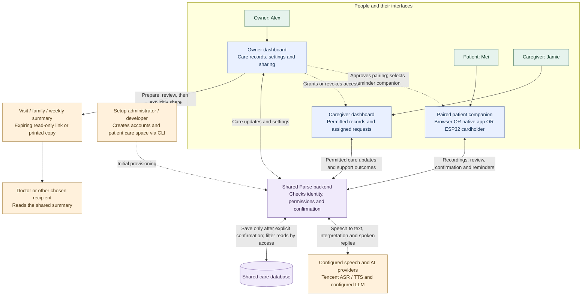
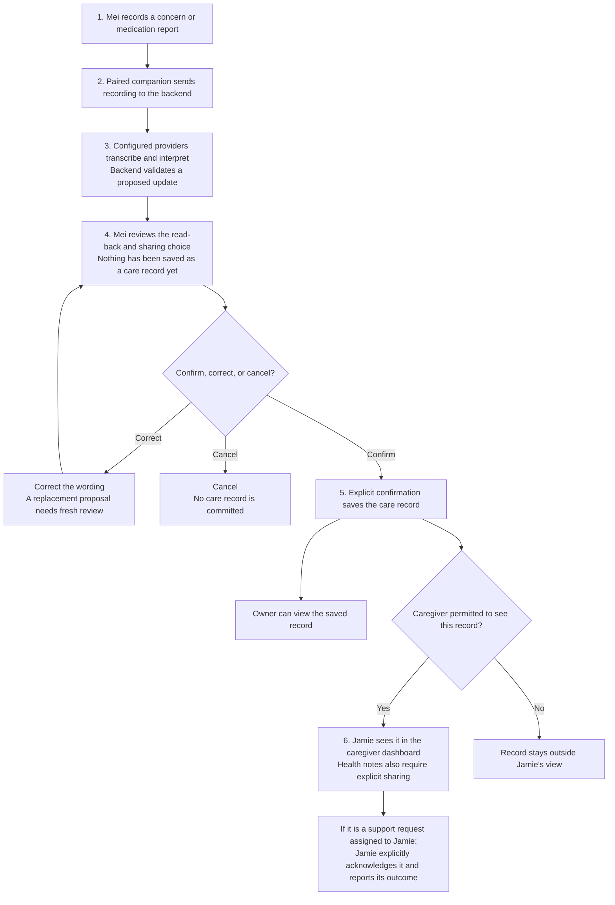

# Parse: users and connected workflow

This map describes the implemented connection paths. The demo people are fictional: Alex is the care-space owner, Mei is the patient, and Jamie is the caregiver. An owner is the person managing a patient's care space; they do not have to be the patient.

## Who connects to what

The owner and caregiver use the same dashboard application with different access grants. Each companion communicates with the shared backend independently. The ESP32 cardholder uses Wi-Fi; the implemented path does not relay its recordings through Bluetooth or through the native app.

Dashed connections represent setup and access decisions. The backend enforces them; one dashboard does not directly authorize requests made by another dashboard or companion.

## A patient's voice update

The owner and a permitted caregiver can also enter care updates through the dashboard. Their care facts follow the same proposal, review and explicit-confirmation process. AI interpretation, reminder playback, and successful upload never count as confirmation of a care fact.

## Other connected workflows

- **Setup:** the administrator provisions accounts and the patient care space; the owner grants caregiver access, approves companions, and chooses the reminder companion.
- **Reminders:** the backend schedules checked medication-plan reminders and optional check-ins for the selected companion. A patient's explicit medication report is separate from whether a reminder played. Browser reminders require an open, active companion page.
- **Caregiver follow-through:** an assigned support request appears in the authorized caregiver's care view. Only its assigned recipient can acknowledge it; reporting a later outcome is a separate action.
- **Appointments and handoffs:** the owner prepares a summary from permitted confirmed records, reviews it, then separately shares a read-only expiring link or prints it. Printed or downloaded copies cannot be revoked.

## Accounts and boundaries

| Person | How they access Parse | Responsibility |
| --- | --- | --- |
| Owner | `owner@careloop.invalid` in the dashboard | Patient settings, companion setup, care records, caregiver access, sharing and summary review |
| Caregiver | `caregiver@careloop.invalid` in the dashboard | Permitted records, reviewed care updates, assigned support requests and outcomes |
| Patient | Owner-approved browser, native app or cardholder | Reports concerns, reviews proposals, explicitly confirms updates and receives reminders |
| Setup administrator | Provisioning commands on the backend | Creates accounts, care spaces and hardware credentials; this is an operational responsibility, not a third dashboard login role |
| Doctor / other summary recipient | Explicitly shared link or printed copy | Reads the reviewed summary; no doctor dashboard account or clinical-system integration is implied |

The current `tools/run_demo.py` session runs the dashboard and backend with fictional data and `CARELOOP_PROVIDER=unconfigured`. Live speech needs separate provider and HTTPS setup. The browser flow has scripted local test evidence; native physical-device acceptance and physical cardholder operation remain unfinished.

Source guides: [First use](First-Use-Guide.md), [browser companion](Web-Companion.md), [native companion](Phone-Companion-Setup.md), [hardware pairing](Hardware-Pairing-Runbook.md), [providers](PROVIDERS.md), [summaries](Summary-Purposes.md), and [verification](VERIFICATION.md).
