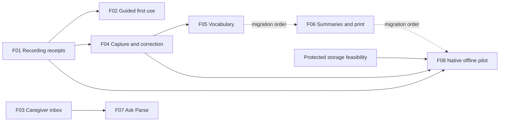

# Parse workflow improvements — delivery roadmap

Date: 2026-10-02. Code baseline: [ce742b8](https://github.com/ClarenceChoo/Tencent-Cloud-Hackathon-Singapore-2026/commit/ce742b89060d92d35c648adc1ed84882b738bd9c).

This roadmap turns the eight Pocket-inspired recommendations into separately scoped feature issues. Implementation has not started. Priorities are delivery order, not promised dates. Each issue contains its complete implementation plan so an engineer can use it before these local documentation files are committed.

Read the [research and evidence](../../research/pocket-workflow-research-2026-10-02.md), then the [shared design specification](../specs/2026-10-02-parse-workflow-improvements-design.md). Product decisions in the specification are planning defaults, not claims that user testing has validated them.

## Issues and plans

| ID | Feature | Priority | Dependencies | GitHub issue | Local implementation plan |
|---|---|---|---|---|---|
| F01 | show recording receipts and reliable recovery states | P1 | None | [#8](https://github.com/ClarenceChoo/Tencent-Cloud-Hackathon-Singapore-2026/issues/8) | [Plan](./2026-10-02-recording-receipts.md) |
| F02 | guide companion setup through the first confirmed update | P1 | F01 | [#9](https://github.com/ClarenceChoo/Tencent-Cloud-Hackathon-Singapore-2026/issues/9) | [Plan](./2026-10-02-guided-first-use.md) |
| F03 | consolidate permitted caregiver actions in a single inbox | P1 | None | [#10](https://github.com/ClarenceChoo/Tencent-Cloud-Hackathon-Singapore-2026/issues/10) | [Plan](./2026-10-02-caregiver-action-inbox.md) |
| F04 | add purpose-specific capture and targeted proposal corrections | P2 | F01 | [#11](https://github.com/ClarenceChoo/Tencent-Cloud-Hackathon-Singapore-2026/issues/11) | [Plan](./2026-10-02-purpose-specific-capture.md) |
| F05 | add reviewed care-space vocabulary and provider capability handling | P2 | F04 | [#12](https://github.com/ClarenceChoo/Tencent-Cloud-Hackathon-Singapore-2026/issues/12) | [Plan](./2026-10-02-reviewed-care-vocabulary.md) |
| F06 | add purpose-specific care summaries and reviewed print output | P2 | F05 | [#13](https://github.com/ClarenceChoo/Tencent-Cloud-Hackathon-Singapore-2026/issues/13) | [Plan](./2026-10-02-purpose-specific-summaries.md) |
| F07 | add bounded source-linked Ask Parse queries | P2 | F03 | [#14](https://github.com/ClarenceChoo/Tencent-Cloud-Hackathon-Singapore-2026/issues/14) | [Plan](./2026-10-02-bounded-ask-parse.md) |
| F08 | validate and pilot protected native offline note capture | P3 | F01, F04, F06 | [#15](https://github.com/ClarenceChoo/Tencent-Cloud-Hackathon-Singapore-2026/issues/15) | [Plan](./2026-10-02-durable-offline-capture.md) |

## Delivery order

1. Start F01 recording receipts and F03 caregiver inbox independently. Add F02 guided first use once receipt semantics are available.
2. Deliver F04 purpose prompts and corrections, then F05 reviewed vocabulary. F06 summaries follows for migration integration, while F07 queries can follow F03 independently.
3. Start F08's storage study whenever physical devices are available. Enable the native pilot only after its storage gate, F01/F04 behavior and ordered migration integration are complete.



Schema order at this baseline: existing 0004_phone_notifications → F04 0005_capture_intent → F05 0006_care_vocabulary → F06 0007_summary_purposes → F08 0008_offline_capture_metadata. Reconcile both revision and down_revision against the actual integration branch before implementing each migration. F06 does not need vocabulary to be enabled; F08 feasibility does not need the preceding features to be shipped.

## What each plan contains

- A concrete user outcome and bounded scope.
- File ownership, proposed interfaces and backward compatibility.
- Five failure cases assigned to implementation/test tasks.
- Checkbox tasks with focused validation and suggested commit boundaries.
- User/API documentation deliverables, acceptance criteria and rollout/rollback behavior.

The common rules preserve explicit confirmation, immutable corrections, permissions, unknown facts and receipt identity. A recording being received, a record being saved, a recipient being allowed to view it and a recipient acknowledging it are separate facts.

## Execution prerequisites and checks

Commands below are for future implementation. Planning did not install dependencies, run application tests or validate hardware. Work from the repository root unless a command explicitly enters backend.

Install pinned dependencies only when implementation starts:

```sh
npm --prefix frontend ci
npm --prefix tools ci
npm --prefix mobile ci
cd backend
uv sync --frozen --extra test
```

Run the exact new tests in each feature plan. Expected result after implementation: the focused suites exit 0 and the new assertions pass. Existing permission, confirmation and recovery tests remain regression checks. Broader gates, from the repository root:

```sh
npm --prefix frontend test
npm --prefix frontend run build
npm --prefix mobile run typecheck
npm --prefix mobile test
```

Run the backend suite from backend:

```sh
uv run pytest
```

Run the isolated PostgreSQL harness from the repository root when backend/schema changes require it; it needs local PostgreSQL binaries and the backend environment:

```sh
backend/.venv/bin/python tools/postgres_test.py
```

Browser workflow fixture, from the repository root, after a successful frontend build. Use a new directory for every run, replacing the example suffix with that run's identifier:

```sh
backend/.venv/bin/python tools/web_companion_fixture.py --data-dir runtime/workflow-feature-run-001 --port 5190
```

Keep the fixture running in one terminal and run the browser scenario from another:

```sh
PARSE_WEB_FIXTURE_DIR=runtime/workflow-feature-run-001 node tools/browser_web_companion.cjs
```

The browser runner uses scripted speech and fictional care data. It does not prove live recognition accuracy, physical speaker/microphone behavior or native lifecycle reliability. Record those acceptance results separately. F08 requires physical-device evidence on every enabled OS.

## Proposed boundaries to preserve during implementation

- F01–F04 focus on the existing browser workflow; shared native contracts remain compatible.
- F05 uses reviewed hints only. Verify current official provider/account support before enabling ASR vocabulary; unsupported providers continue normal recognition.
- F06 uses deterministic summaries, distinct authored questions and browser print. Reviewed share-link protection does not revoke a printed/downloaded copy.
- F07 initially supports three explicit questions and up to 50 multi-row results. No general medical chatbot or external model is introduced.
- F08 initially supports foreground, opt-in native capture of private notes with a 10-clip, 20-second, 2-MiB-per-clip, 24-hour queue. Browser and pendant durable queues are outside this plan.

## Planning verification

Checked against the code at the baseline above: feature ownership, existing API and test locations, authorization boundaries, migration ordering, current browser/native recovery, and internal document links. These are documentation checks, not evidence that the proposed features or tests already exist. The research and planning documents remain local until deliberately committed; the issue bodies carry the reviewable plans independently.
