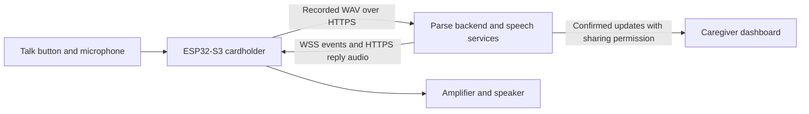

# Parse cardholder: ESP32-S3 firmware setup

This guide takes your **ESP32-S3-WROOM-1 N16R8** development board through building, flashing, provisioning, and first physical checks. With its audio hardware connected, the cardholder records during a deliberate button hold, uploads a WAV turn, and plays server-approved speech, reminders, and check-ins. The backend handles speech recognition, care proposals, confirmation, and caregiver permissions. There is no local speech recognition, medical reasoning, or treatment logic.

**The repository is not a ready-to-flash board image.** All supplier-dependent GPIOs default to `-1`, leaving the button, microphone, speaker, and haptics inert. The checked-in defaults now configure this N16R8 module: 16 MB Quad-SPI flash and 8 MB Octal-SPI PSRAM at 80 MHz, initialized at boot and exposed to the capability allocator. Recording still requires that PSRAM to initialize successfully on the physical board. This project supports **ESP32-S3 only**. It is a C **ESP-IDF** project, not an Arduino `.ino` sketch: ESP-IDF provides the compiler, build system, menu configuration, flasher, monitor, and NVS tools. Arduino IDE's Upload command is not this workflow.

The product is called Parse. The firmware source, configuration names and setup Wi-Fi still use the earlier CareLoop name.

**In this guide:** [Before you begin](#before-you-begin) · [What the code does](#what-the-code-does) · [Install and make a no-space checkout](#1-install-esp-idf-v542-in-a-path-without-spaces) · [Configure and build](#2-configure-your-board-and-build) · [N16R8 board notes](#esp32-s3-wroom-1-n16r8-board-notes) · [Flash](#3-find-the-usb-port-and-flash-the-application) · [Create the private pack](#4-provision-a-unique-device-token-and-setup-password) · [Flash NVS](#5-generate-and-flash-nvs-separately) · [Pair and test](#6-first-boot-owner-pairing-and-bench-test) · [Troubleshooting](#troubleshooting-and-recovery) · [Protocol](#firmware-protocol-reference) · [Source files](#where-to-look-in-the-source)

## Before you begin

The supplied listing identifies an **ESP32-S3-WROOM-1-N16R8** module: its module has 16 MB flash and 8 MB Octal-SPI PSRAM, as specified in the [module datasheet](https://www.espressif.com/sites/default/files/documentation/esp32-s3-wroom-1_wroom-1u_datasheet_en.pdf). This identifies the module memory, but does not identify the exact 44-pin carrier PCB, its USB circuit, GPIO routing, or power wiring. Still obtain the seller's board revision and signed GPIO/power diagrams, microphone left/right selection, amplifier/speaker wiring and enable polarity, button and motor-driver polarity, USB data port, and BOOT/RESET procedure. The [supplier checklist](../docs/careloop/Supplier-Handoff-Checklist-ZH.md) requests a bench-tested unit. Do not copy another ESP32-S3 board's pin map. A USB **data** cable, a 2.4 GHz WPA2 Wi-Fi network or compatible hotspot, and a computer with Git/Python are also needed. The listing does not include audio peripherals; full voice use requires an external INMP441-compatible microphone, MAX98357A-compatible amplifier and speaker, plus a separately wired/configured talk button.

You can still complete the first USB board-only build and flash before the backend is deployed or the audio hardware is wired. Leave all CareLoop peripheral GPIOs at `-1`; the expected `Audio remains disabled` boot log confirms the safe unconfigured state. Follow the N16R8 settings below, then build, flash and monitor. Provision NVS and pair with the backend later. The onboard BOOT button is for download/bootloader entry; it is not the configured talk button, and GPIO0 must not be assigned as PTT on that assumption.

For owner pairing and online tests, deploy the backend at a real HTTPS origin with a valid certificate, then have an owner/care space and private device setup pack created against **that same backend database**. This is not needed for the board-only build and flash above. Follow the [deployment guide](../deploy/README.md), [backend setup](../backend/README.md), and [hardware pairing runbook](../docs/careloop/Hardware-Pairing-Runbook.md). Tencent/LLM credentials stay on the backend, never on the cardholder.

Some terms used in the steps below:

| Term | Meaning here |
|---|---|
| Firmware / flashing | The program running on the board / writing that program to its flash storage over USB. |
| GPIO | A numbered chip pin assigned to a button, audio signal or other hardware connection. |
| I²S | The digital audio connection between the ESP32-S3 and its microphone/amplifier. |
| PSRAM | External working memory used for the recording buffer. It is separate from flash storage; the full buffer is 640,044 bytes. |
| NVS | Non-volatile storage: a flash partition holding Wi-Fi settings, this unit's credential, setup password and command ledger across restarts. |
| HTTPS / WSS | Encrypted web requests for audio and an encrypted WebSocket connection for results, commands and heartbeats. |
| ASR / LLM / TTS | The backend's speech recognition, language-model processing and text-to-speech services. |

## What the code does



The path through one interaction is:

1. First boot opens a password-protected `CareLoop-XXXX` setup Wi-Fi. The owner enters 2.4 GHz Wi-Fi and the HTTPS service origin. The unit connects to Wi-Fi, synchronizes time, opens authenticated WSS, and sends a heartbeat about every five seconds.
2. A deliberate button hold gives one short haptic cue and captures 16 kHz mono WAV until release or 20 seconds. Clips shorter than 0.3 seconds are rejected. The amplifier is off during capture. The WAV exists temporarily in PSRAM, not in flash.
3. The unit uploads the WAV with its bearer token and one idempotency key. Bounded retries reuse that key. Two short pulses indicate accepted upload. Another press while the accepted turn is processing gives three short pulses; it does not overwrite that turn. An uncertain receipt is reported as uncertain, not as definitely unsent.
4. The backend returns a result over WSS or HTTPS turn polling. HTTPS recovery continues when WSS is unavailable, provided Wi-Fi and the device credential remain available. Approved reply WAVs play in sequence. A press interrupts playback; a later deliberate recording can carry the still-valid context for correction or confirmation. The unexpired reply context survives interruption, including a new confirmation proposal, while an explicit null context clears the previous conversation. **Recording alone never creates a confirmed care fact.** The backend's explicit confirmation flow must complete.
5. The server can send reminder and nonclinical check-in audio. Reminder playback requires synchronized time, current matching plan version, and an unexpired command. A persisted NVS ledger suppresses redelivery after reboot. Interrupted or unknown reminders are not silently replayed. Check-ins preserve context for a later deliberate response and are not marked complete after failed/interrupted audio.

“Online” means a recent authenticated backend heartbeat, not that audio, power, voice providers, or physical care workflow have passed acceptance.

## 1. Install ESP-IDF v5.4.2 in a path without spaces

Use Espressif's exact [macOS/Linux setup](https://docs.espressif.com/projects/esp-idf/en/v5.4.2/esp32s3/get-started/linux-macos-setup.html) or [Windows setup](https://docs.espressif.com/projects/esp-idf/en/v5.4.2/esp32s3/get-started/windows-setup.html), including its operating-system prerequisites. **ESP-IDF's build system does not support spaces in the ESP-IDF or project path.** This repository workspace is named `Tencent Hackathon`, so do not build from that path even with shell quotes. Put a working checkout at `~/esp/parse` (macOS/Linux) or `C:\esp\parse` (Windows).

On macOS, install Apple's command line tools with `xcode-select --install` **if they are missing** (for example, `xcrun` reports an invalid developer path). With Homebrew installed, run `brew install cmake ninja dfu-util`; if `python3` is missing, run `brew install python3`. On Debian/Ubuntu, install Espressif's listed prerequisites:

```sh
sudo apt-get update
sudo apt-get install git wget flex bison gperf python3 python3-pip python3-venv cmake ninja-build ccache libffi-dev libssl-dev dfu-util libusb-1.0-0
```

For other Linux distributions, use the matching section of Espressif's setup guide. Then, on macOS/Linux, install ESP-IDF and clone this repository into a no-space path:

```sh
mkdir -p ~/esp
git clone -b v5.4.2 --recursive https://github.com/espressif/esp-idf.git ~/esp/esp-idf-v5.4.2
cd ~/esp/esp-idf-v5.4.2
./install.sh esp32s3
. "$HOME/esp/esp-idf-v5.4.2/export.sh"
idf.py --version
git clone https://github.com/ClarenceChoo/Tencent-Cloud-Hackathon-Singapore-2026.git "$HOME/esp/parse"
cd "$HOME/esp/parse/firmware"
```

Use an existing exact `v5.4.2` checkout if present. In each later terminal, source that checkout's `export.sh` again. On Windows, install/select **ESP-IDF v5.4.2** and ESP32-S3 tools using Espressif's Windows installer. Open the installer-provided **ESP-IDF Command Prompt for v5.4.2**, then run:

```bat
idf.py --version
mkdir C:\esp
git clone https://github.com/ClarenceChoo/Tencent-Cloud-Hackathon-Singapore-2026.git C:\esp\parse
cd /d C:\esp\parse\firmware
```

These clone commands are for a clean checkout; skip cloning if the destination already exists. If your current checkout contains firmware changes, copy its `firmware/` **source** into the new checkout before configuring the board. On macOS/Linux, one option from the current repository root is `rsync -a --exclude build --exclude managed_components --exclude sdkconfig --exclude sdkconfig.old firmware/ "$HOME/esp/parse/firmware/"`. On Windows, copy the corresponding source files into `C:\esp\parse\firmware`, excluding `build`, `managed_components`, `sdkconfig`, and `sdkconfig.old`. Generated artifacts refer to the old path/configuration and must be regenerated. The manifests allow IDF `>=5.4.2,<5.5`; v5.4.2 is the documented and historically built release. The component manifests pin `espressif/esp_websocket_client` 1.4.0, which the component manager may download on first build.

## 2. Configure your board and build

From your **no-space repository checkout**, enter `firmware/` if you are not already there (`cd "$HOME/esp/parse/firmware"` on macOS/Linux, or `cd /d C:\esp\parse\firmware` in Windows CMD). `set-target` resets generated target configuration, so run it before board-specific `menuconfig` changes:

```sh
idf.py set-target esp32s3
idf.py menuconfig
```

In menuconfig, use the arrow keys to move, Enter to open a menu, Space to toggle a checkbox, and `/` to search for a setting by name. Use Save before exiting. Settings are written to `firmware/sdkconfig`, with names prefixed by `CONFIG_`.

For the first upload with the development board alone, leave the CareLoop GPIO settings at `-1` and go to the **N16R8 board notes** below. Assign audio/button pins when those peripherals are wired. GPIO numbers refer to the board's printed GPIO labels, not the position of a pin in the 44-pin header.

In **CareLoop hardware (supplier must confirm every pin)**, assign these keys from the signed wiring table:

| Keys | Hardware confirmation |
|---|---|
| `CARELOOP_MIC_BCLK_GPIO`, `CARELOOP_MIC_WS_GPIO`, `CARELOOP_MIC_DATA_GPIO`, `CARELOOP_MIC_LEFT_CHANNEL` | Microphone I²S wiring and strapped left/right channel. |
| `CARELOOP_SPK_BCLK_GPIO`, `CARELOOP_SPK_WS_GPIO`, `CARELOOP_SPK_DATA_GPIO` | Amplifier I²S wiring. |
| `CARELOOP_AMP_ENABLE_GPIO`, `CARELOOP_AMP_ENABLE_ACTIVE_HIGH` | Enable pin/active level, or `-1` only if the board truly has no controlled enable. |
| `CARELOOP_PTT_GPIO`, `CARELOOP_PTT_ACTIVE_LOW` | Talk button GPIO and pressed level. This button is also used for Wi-Fi recovery. |
| `CARELOOP_HAPTIC_GPIO`, `CARELOOP_HAPTIC_ACTIVE_HIGH` | **Motor-driver** enable and polarity; a motor must not be driven directly from GPIO. |
| `CARELOOP_BATTERY_ADC_GPIO` | Supplier battery-sense pin or `-1`. This key is declared but the present firmware does **not** read/report battery voltage or automatically trigger its embedded low-battery prompt. Do not treat it as a working battery monitor. |

The [example configuration](sdkconfig.careloop.example) leaves pins at `-1` intentionally. Also set **Serial flasher config → Flash size** to the actual module capacity. Under **Component config → ESP PSRAM**, enable PSRAM support and startup initialization, choose the supplier-confirmed PSRAM mode/type, and select **Make RAM allocatable using `heap_caps_malloc(..., MALLOC_CAP_SPIRAM)`** or the option that also exposes it through `malloc()`. The capture code explicitly calls `heap_caps_malloc` with `MALLOC_CAP_SPIRAM`; mapping RAM without adding it to the capability allocator is insufficient. Without working external PSRAM, capture returns an error rather than using ordinary heap. Follow Espressif's [v5.4.2 external RAM guide](https://docs.espressif.com/projects/esp-idf/en/v5.4.2/esp32s3/api-guides/external-ram.html) and the actual module datasheet; do not guess PSRAM wiring, voltage or mode. Keep **Partition Table → Custom partition table CSV** pointing to `partitions.csv`: `nvs` at `0x9000` size `0x6000`, `phy_init` at `0xf000`, and one factory app at `0x10000` size `0x1a0000`. The app partition ends at `0x1b0000`, so at least 2 MB flash is required. There is no OTA app slot. If the supplier changes the table, recheck image fit and the NVS steps below.

### ESP32-S3-WROOM-1-N16R8 board notes

The module marking from the listing is specific enough to configure its memory: choose **16 MB** under **Serial flasher config → Flash size** and **Octal Mode PSRAM** under **Component config → ESP PSRAM → SPI RAM config → Mode (QUAD/OCT)**. Enable PSRAM support and boot initialization, and expose it to the capability allocator because capture requests `MALLOC_CAP_SPIRAM`. These paths and symbols are from the [ESP-IDF v5.4.2 configuration reference](https://docs.espressif.com/projects/esp-idf/en/v5.4.2/esp32s3/api-reference/kconfig.html). The relevant saved `sdkconfig` values are:

| Menu setting | `sdkconfig` value |
|---|---|
| Serial flasher config → Flash size → 16 MB | `CONFIG_ESPTOOLPY_FLASHSIZE_16MB=y` |
| Component config → ESP PSRAM support | `CONFIG_SPIRAM=y` |
| SPI RAM config → Mode (QUAD/OCT) → Octal | `CONFIG_SPIRAM_MODE_OCT=y` |
| SPI RAM config → Initialize SPI RAM when booting | `CONFIG_SPIRAM_BOOT_INIT=y` |
| SPI RAM config → Make RAM allocatable with `heap_caps_malloc(..., MALLOC_CAP_SPIRAM)` | `CONFIG_SPIRAM_USE_CAPS_ALLOC=y` |
| Serial flasher config → Flash SPI speed → 80 MHz | `CONFIG_ESPTOOLPY_FLASHFREQ_80M=y` |
| SPI RAM config → SPI RAM speed → 80 MHz | `CONFIG_SPIRAM_SPEED_80M=y` |

These memory settings are now supplied by `sdkconfig.defaults` for a fresh configuration. An existing `sdkconfig` keeps its previous choices: check the values above in menuconfig before rebuilding. These are menuconfig settings saved in `sdkconfig`, not commands to paste into the shell. The N16R8 uses Quad flash and Octal PSRAM: leave **Octal flash** (`CONFIG_ESPTOOLPY_OCT_FLASH`) disabled. The documented 80 MHz flash / 80 MHz PSRAM settings are a supported starting point for this memory combination; see Espressif's [flash and PSRAM configuration guide](https://docs.espressif.com/projects/esp-idf/en/v5.4.2/esp32s3/api-guides/flash_psram_config.html). You can instead enable the option that integrates PSRAM into `malloc()` (`CONFIG_SPIRAM_USE_MALLOC=y`), which also makes it available to capability allocation. Firmware initialization rejects GPIO35, GPIO36 and GPIO37 because Octal PSRAM uses them, and GPIO26–34 because those module pins are internal. It also rejects invalid GPIOs, output signals assigned to input-only pins, and duplicate peripheral assignments before configuring hardware. GPIO19/20 are rejected when a primary or secondary USB Serial/JTAG console is enabled. If using the ESP32-S3 native USB Serial/JTAG connection, GPIO19/20 are also dedicated to USB. The listing does not establish whether the carrier board's Type-C connector is wired to native USB or to a USB-to-UART bridge, so consult its documentation: native USB requires **Component config → ESP System Settings → Channel for console output → USB Serial/JTAG Controller** (`CONFIG_ESP_CONSOLE_USB_SERIAL_JTAG=y`); a USB-to-UART bridge normally uses the UART0 default. Connect the port appropriate to the selected console. A native USB connection may re-enumerate after BOOT/reset, so rediscover its port if it disappears.

The 16 MB flash capacity does not change this project's custom partition table: the factory app remains `0x1a0000` bytes, with no OTA slot. Its historical source-check image had only 1% free space, and that limit remains until a board-specific build is checked. If boot reports PSRAM detection or initialization errors, verify the selected Octal mode, support and boot initialization against the N16R8 module, then rebuild and reflash. A QUAD-mode mismatch can prevent the module's Octal PSRAM from initializing. Do not alter voltage settings based on the listing alone.

Save menuconfig, then from `firmware/`:

```sh
idf.py build
idf.py size
```

**Milestone 1 — build fits:** `idf.py build` completes without a partition-size error, and `idf.py size` reports the application's memory usage. The application must fit the `0x1a0000` factory partition. A successful build with `-1` pins is still an inert source-check image. Preserve your board-specific configuration privately.

## 3. Find the USB port and flash the application

Use a USB **data** cable. Compare `ls /dev/cu.*` before/after plugging in on macOS; compare `ls /dev/ttyACM* /dev/ttyUSB*` on Linux (missing-glob messages are harmless); or compare **Device Manager → Ports (COM & LPT)** on Windows. Select the newly appeared board port. From `firmware/`, with the ESP-IDF environment active, replace the example port:

```sh
idf.py -p /dev/cu.usbmodemXXXX flash
idf.py -p /dev/cu.usbmodemXXXX monitor
```

Linux ports commonly look like `/dev/ttyACM0` or `/dev/ttyUSB0`; Windows ports look like `COM3`. `flash` writes bootloader, partition table and application and will build if needed. `monitor` displays serial logs. You may combine them as `idf.py -p PORT flash monitor`; exit monitor with **Ctrl+]** and close any other serial monitors before the NVS write in step 5. The setup password and token are not printed in normal logs. **Milestone 2 — application written:** the flasher reports successful writes and verified hashes, then monitor shows boot logs. A first boot before NVS provisioning may open the setup AP, but it cannot authenticate to the backend yet; after NVS and Wi-Fi setup, use the dashboard heartbeat and physical audio test for the final milestone.

With the N16R8 memory settings, look for successful PSRAM initialization and a detected capacity of 8 MB in the boot log. With unwired peripheral pins left at `-1`, `Audio remains disabled` is expected. Before the private pack is flashed, the setup AP has a generated password that is not printed; step 5 installs the password from `owner-setup.txt` so you can join it for Wi-Fi setup.

If automatic download-mode reset fails, follow the supplier's BOOT/RESET procedure. A common sequence is to hold **BOOT**, tap **RESET**, release **BOOT**, then rerun `flash`; reset after flashing if it does not restart. Check for a charge-only cable, the wrong port, missing Linux serial permissions, or another monitor holding the port before changing anything else. Keep USB data and boot/reset access in the enclosure design.

## 4. Provision a unique device token and setup password

The firmware image contains no Wi-Fi password, backend URL, device token or certificate bypass. Create one private pack per unit on the backend host, against the **same database** serving the deployed API. From `backend/` on that host with its database environment configured:

```sh
CARELOOP_ADMIN_ENABLED=true .venv/bin/python -m app.admin prepare-device \
  --backend-url https://YOUR-ACTUAL-DOMAIN \
  --output-dir /PRIVATE/NEW-DIRECTORY/pendant-001 \
  --claim-minutes 60
```

Replace the illustrative hostname and directory; the output directory must be new. The [pairing runbook](../docs/careloop/Hardware-Pairing-Runbook.md) has the equivalent Docker command. This writes a private `device-nvs.csv` (token, setup-network password, HTTPS origin), `owner-setup.txt` (one-use pairing code/expiry and owner instructions), and `device.json` (ID and non-secret NVS metadata). The pairing code, setup-network password, and bearer token are different values. The backend stores only credential/code hashes. Do not put the CSV or generated NVS binary in Git, public chats or issues. A claim code can be renewed for an unclaimed, unrevoked unit without reflashing; see the runbook. Physical flash extraction protection is a separate production-hardening task.

The generated CSV creates the `careloop` NVS namespace with `token`, `setup_pw`, and `backend` strings. The setup form later writes `ssid` and `pass`; firmware also persists its reminder `ledger` blob there. Use the backend-generated CSV instead of hand-authoring credentials. The backend origin must be `https://` plus host only, with no path, query or trailing slash.

## 5. Generate and flash NVS separately

Application flashing does **not** create the unit-specific token. From the **no-space repository root**, with the same ESP-IDF v5.4.2 environment active, substitute this unit's private paths and USB port:

```sh
umask 077
python "$IDF_PATH/components/nvs_flash/nvs_partition_generator/nvs_partition_gen.py" generate \
  /PRIVATE/pendant-001/device-nvs.csv /PRIVATE/pendant-001/device-nvs.bin 0x6000
python "$IDF_PATH/components/partition_table/parttool.py" --port YOUR-USB-PORT \
  write_partition --partition-name nvs --input /PRIVATE/pendant-001/device-nvs.bin
```

On Windows use the **ESP-IDF Command Prompt for v5.4.2**, private Windows paths, and `%IDF_PATH%`. Copy this unit's `device-nvs.csv` from the backend-created setup pack into the illustrative `C:\private\pendant-001` directory first. From `C:\esp\parse` (`cd /d C:\esp\parse`), the equivalent is:

```bat
python "%IDF_PATH%\components\nvs_flash\nvs_partition_generator\nvs_partition_gen.py" generate C:\private\pendant-001\device-nvs.csv C:\private\pendant-001\device-nvs.bin 0x6000
python "%IDF_PATH%\components\partition_table\parttool.py" --port COM3 write_partition --partition-name nvs --input C:\private\pendant-001\device-nvs.bin
```

Replace `COM3` and the private directory. `umask` is macOS/Linux only; restrict access to the Windows directory instead. The `0x6000` size and `nvs` name match [partitions.csv](partitions.csv). [Espressif's NVS generator documentation](https://docs.espressif.com/projects/esp-idf/en/v5.4.2/esp32s3/api-reference/storage/nvs_partition_gen.html) explains its CSV. Keep the `.bin` private as it contains the token. Writing a new NVS image later overwrites saved Wi-Fi and the replay ledger; use the button recovery gesture for ordinary Wi-Fi changes.

## 6. First boot, owner pairing and bench test

1. Reset the unit and watch `idf.py -p PORT monitor`. With no saved Wi-Fi, it starts a WPA2 `CareLoop-XXXX` setup AP for **ten minutes** and one client. The suffix comes from its MAC address; the 16-character password is in `owner-setup.txt`, never the serial log. Reset to reopen an expired setup window.
2. Sign in as the owner in Parse. Open **Settings → Pair your cardholder**, enter the one-use code from the sheet, and select **Pair cardholder**. “Paired · waiting for connection” proves account binding, not device connectivity.
3. Join `CareLoop-XXXX` using the setup password and open `http://192.168.4.1/`. The setup network has no internet access; keep the phone joined to it while opening the local page. Enter the real 2.4 GHz WPA2 SSID/password and the same HTTPS origin as the pack. Saving restarts the unit. Rejoin your normal phone network.
4. Check that the device gets a station IP and authenticated WSS connection, then appears **Online**. The backend considers a heartbeat fresh for about 15 seconds. If transport is working but the button does nothing, inspect pin mapping and PSRAM.
5. With live ASR/LLM/TTS configured, hold the talk button, speak a short **fictional** note, release, listen to the read-back, correct if needed, and explicitly confirm. Verify exactly one timeline entry. Check sharing with the chosen caregiver and denial for an unapproved caregiver.
6. Test one fictional reminder and check-in, pressing during playback, Wi-Fi loss/recovery, restart, and the supplier's physical measurements: intelligibility, motor noise, battery/current behavior, charging, and card/Wi-Fi interference. Record the exact board revision, config and results. None is established by compilation.

From the **no-space repository root** on macOS/Linux, with the deployment address and this unit's private setup pack available, run the [hardware readiness checker](../tools/check_hardware_ready.py):

```sh
backend/.venv/bin/python tools/check_hardware_ready.py \
  --base-url https://YOUR-ACTUAL-DOMAIN \
  --nvs-file /PRIVATE/pendant-001/device-nvs.csv \
  --require-voice-config
```

It checks TLS, bound identity, audio protocol, reconciliation and an authenticated diagnostic WSS heartbeat without recording audio or creating a care record. The `--require-voice-config` option checks provider **configuration**, not a successful paid-provider call. Its own diagnostic connection is **not** proof that the physical unit is online; disconnect the checker and observe the actual unit's heartbeat. The [pairing runbook](../docs/careloop/Hardware-Pairing-Runbook.md) explains result codes and the Docker deployment path.

**Milestone 3 — online and physically working:** after NVS and Wi-Fi setup, the owner's dashboard shows **Online** from the actual cardholder, and a deliberate hold/release produces a real recording and audible reply. If a vibration motor and its driver are connected and configured, expect one short haptic cue before capture and two short pulses after an accepted upload; three short pulses on a further press mean the accepted turn is still processing. The serial log can help distinguish disabled audio (`Audio remains disabled`) or a capture allocation problem (`capture unavailable`), while dashboard status alone cannot establish sound quality. Complete the explicit fictional-note confirmation and reminder/check-in bench checks above before calling the unit accepted.

## Troubleshooting and recovery

| Symptom | Check or action |
|---|---|
| `idf.py` missing or wrong version | Activate v5.4.2 in this terminal. Check `idf.py --version` and `$IDF_PATH` (Windows CMD: `%IDF_PATH%`). Keep both IDF and project paths free of spaces. |
| Build succeeds but no button/audio | With pins still `-1`, `Audio remains disabled` is expected for the board-only flash. For full voice operation, compare generated `sdkconfig` with the signed supplier wiring table. Capture also needs boot-initialized Octal PSRAM on N16R8. Look for `Audio remains disabled` or `capture unavailable` in monitor. |
| N16R8 PSRAM not found or capture allocation fails | Check 16 MB flash and Octal PSRAM mode, PSRAM support, boot initialization and allocator settings above. GPIO35/36/37 are occupied by the module PSRAM. Rebuild and reflash after changing menuconfig. |
| Flash cannot connect | Recheck data cable, appeared port, power, serial access and supplier BOOT/RESET procedure. Close other monitors. |
| Flash succeeds but monitor has no application logs | Match the console setting to the board's USB connection: UART0 for a USB-to-UART bridge, or USB Serial/JTAG Controller for native USB. Recheck the serial port after BOOT/reset, then reset with monitor open. |
| No setup AP | On an unconfigured unit reset it; the AP expires after ten minutes. On a configured unit hold the **configured talk button while powering on for five seconds**; after two pulses, release. This clears only saved SSID/password, preserving token, backend, setup password and reminder ledger. This compiled gesture still needs physical validation. |
| Setup form rejects service address | Use the exact `https://` public origin with no path, query, fragment, space or trailing slash. |
| Paired but not Online | Check 2.4 GHz WPA2/hotspot, DNS, public TLS certificate, address, flashed token and deployed database. Pairing alone is not a heartbeat. |
| Online but no reply/reminder | Check backend processing and live providers, I²S wiring/audio and time sync. Reminder playback also requires the current plan version. A press during playback intentionally stops it. |
| NVS tool errors | Confirm this unit's `prepare-device` CSV, v5.4.2 tools, `0x6000` partition and correct port; do not paste credentials into diagnostic messages. |

`idf.py -p PORT erase-flash` removes Wi-Fi, device credential, and replay ledger as well as the app. It is deliberate factory recovery: rebuild/reflash the app and regenerate/reflash **this unit's** NVS afterward. A revoked device needs a fresh backend credential/setup pack. No normal Wi-Fi change requires erasing flash.

## Firmware protocol reference

The following details help backend and firmware developers interpret a bench result. The owner-facing sequence is above.

`POST /v1/device/turns` receives `audio/wav` with `Authorization: Bearer`, a UUID `Idempotency-Key`, and optional `X-Context-Id`. Every retry for one capture reuses the UUID. The implementation accepts a `turn_id` response and awaits a WSS `turn.result` with `payload.context_id`. A response can carry `payload.audio_paths`: an ordered array of 1–20 relative `/v1/device/audio/...` WAV assets, each no longer than 20 seconds, with a total sequence no longer than 120 seconds. Firmware validates every path, keeps the microphone disabled through the full sequence, and treats a button press as interruption of the entire sequence. It retains `audio_path` as the first-asset fallback for compatible servers. It also polls `GET /v1/device/turns/{turn_id}` after an accepted upload. While Wi-Fi and a device credential are available, pending-command reconciliation and accepted-turn recovery run at most once per five-second attempt interval (network timeouts can extend recovery latency) even if WSS disconnects or its client cannot start. Only heartbeats require a connected WebSocket. The implemented response is `{turn_id,status,received_at,event,error}`, where `event` is the same complete `turn.result` envelope or null. This lets a lost socket recover the durable result while the firmware remains running, without creating another care record. The outstanding turn ID and context are in RAM, not durable across a device reboot.

For safe reminder playback, `GET /v1/device/pending-commands` must return `current_plan_version` and an array `commands` of the documented full `reminder.play` event envelopes. The firmware refuses reminder playback until a current plan version is known and matches the command. Receipt and playback start require a successful NVS ledger commit. A failed start commit blocks audio, and a failed terminal commit withholds the terminal acknowledgement. Post-start audio failures persist an unknown state that suppresses replay, including when NVS writes a replacement blob before reporting an error; redelivered commands are suppressed after reboot. Interrupted/unknown reminders are never automatically replayed. The same endpoint may return `checkins` with full nonclinical `checkin.play` envelopes. Check-ins use the same bounded sequential WAV playback and acknowledgement stages, preserve their `context_id` for a later deliberate turn, and are never marked complete after interruption or failed audio. Relative audio paths are allowlisted to `/v1/device/audio/`; server text cannot redirect a device to another host.

The device sends WSS heartbeats every five seconds and uses the configured base URL only. HTTPS redirects are disabled so the bearer token is never forwarded to another host. HTTP reconciliation bodies and each WSS JSON event are bounded at 16 KiB; fragmented WSS events are reassembled by the component-provided offset before parsing, and overflow fails closed. It retains a capture in RAM for up to four total upload attempts within a 60-second bound, with delays after the first three failures of roughly 1, 2, and 4 seconds plus bounded jitter; it neither writes voice clips to flash nor creates a new idempotency key on retry. Reviewed fixed local WAV prompts for disconnected, not-sent, receipt-unconfirmed, processing-failed, saved, and low-battery states are embedded in the firmware. The battery ADC setting is currently unused, so the low-battery prompt has no automatic voltage trigger. All embedded prompts still require playback/acoustic verification on the delivered board.

## Historical build and physical validation boundary

ESP-IDF v5.4.2 compiled this project, including the Wi-Fi setup boot gesture, for `esp32s3` on 23 September 2026. The resulting factory image is 0x19a490 bytes, with 0x5b70 bytes free (1%) in the 0x1a0000-byte factory partition. Its SHA-256 is `c3b1e9e72dfd45d7e0475683c822fb26b62314c5944df32420314a2d608ddd7d`. This is a source-check build with unassigned GPIOs and PSRAM disabled, not a board-specific release image. Host tests passed then for WAV validation/conversion, reply-array and single-path fallback selection, terminal-turn recovery status, context-expiry gating, retry/ledger protocol, and interaction-state logic. Rebuild and recheck image fit after applying the supplier's pin/PSRAM configuration.

Compilation and host tests establish source-level behavior only. This firmware has not been flashed or tested on a cardholder in this workspace. Acoustic intelligibility, motor noise, pin electrical safety, Wi-Fi/card interference, charging, brownouts, and end-to-end physical acceptance require the delivered board and the bench sequence in the integration document.

## Where to look in the source

- [`main/app_main.c`](main/app_main.c): boot gesture, button interaction, haptic cues, capture and upload retries.
- [`main/board_audio.c`](main/board_audio.c): I²S setup, PSRAM capture, PCM conversion and playback. Both microphone and speaker GPIO triples must be valid before either I²S driver starts.
- [`main/wifi_setup.c`](main/wifi_setup.c): setup AP, form and station reconnect.
- [`main/settings.c`](main/settings.c): NVS settings, setup password and command ledger.
- [`main/device_network.c`](main/device_network.c): authenticated HTTPS/WSS, result recovery, reminders and check-ins.
- [`components/careloop_core/`](components/careloop_core/): portable WAV, protocol and interaction helpers. Run their pure host tests from `firmware/` with `make -C components/careloop_core/test test`.
- [`backend/API.md`](../backend/API.md): complete server API examples and authorization contract.

## Firmware host regression checks

Run from the repository root:

```sh
make -C firmware/components/careloop_core/test test
make -C firmware/test test
```

The application suite compiles the actual `board_audio.c` and `device_network.c` translation units with test-only ESP-IDF boundary doubles. It covers N16R8 GPIO restrictions, unused MCLK routing, final queued PCM transmission, interruption and drain errors, failed command-ledger persistence, reboot suppression, and interrupted/cleared/expired reply contexts. JSON parsing and physical DMA timing are not simulated; verify those through the ESP-IDF build and physical bench checks. Normal playback appends a bounded ring of silence to drain the legacy I2S pipeline before turning off the amplifier; error and interruption paths stop immediately.

For sanitizer checks with a supporting host compiler:

```sh
make -C firmware/test BUILD=/tmp/careloop-firmware-sanitized CFLAGS='-std=c11 -O1 -g -Wall -Wextra -Werror -fsanitize=address,undefined -fno-omit-frame-pointer' test
```

A fresh ESP-IDF v5.4.2 build on 3 October 2026 passed with the N16R8 defaults above. Its app image is `0x19daa0` bytes, leaving `0x2560` bytes (9,568 bytes, about 1%) in the existing `0x1a0000` factory partition. This is a compile/configuration check with disabled peripheral GPIOs. Physical PSRAM detection, wiring, acoustic output and end-to-end behavior still require the actual board. The partition remains nearly full; check image fit after further firmware or board configuration changes.
